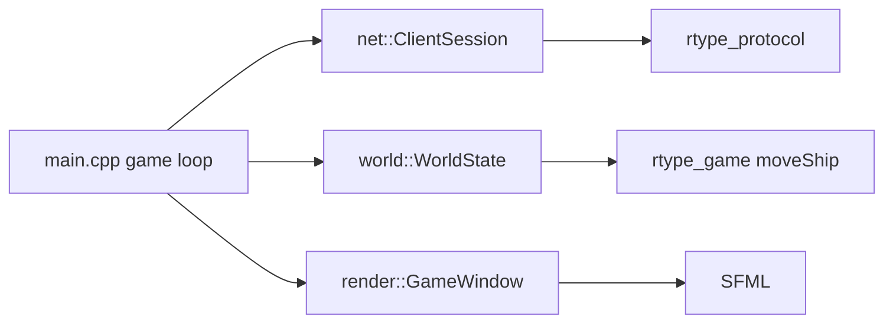

# Client

The client is split so that only one file knows the window library.



| Part | Role |
| --- | --- |
| `net::ClientSession` | UDP socket (asio), handshake, input sending (last 4 samples per datagram), reliable channel, keepalive, 5 s silence timeout. Driven by `update()` each frame, never blocks |
| `world::WorldState` | The game as the client knows it, built from the server messages. Interpolates other entities 100 ms in the past, extrapolates with the spawn velocity for at most 1 s, forgets entities silent for 2 s |
| `render::GameWindow` | The only SFML code: window scaled with black bars from a fixed 1280 x 720 space, keyboard by physical key, sprites, HUD, generated sounds |
| `main.cpp` | Fixed-step loop at the tick rate of the server: read keys, send them, predict, draw |

## Prediction and reconciliation

The own ship moves at once with `rtype::game::moveShip`, the very function the server runs each
tick. Each key sample is numbered and kept. A snapshot gives the authoritative position and
`input_ack`, the last sample the server applied: the client drops the acknowledged samples, starts
from the server position and replays the others. When the server disagrees (a wall, a hit) the
ship snaps to the server position, so the server always has the last word.

## HUD feed

`HudFeed` (`client/src/Hud/HudFeed.cpp`, SFML-free) sits between the loop and the HUD models. The
loop gives it each server message; it validates the kinds and phases, tracks the last known x of
each entity and publishes the events of the `EventBus`. `HudController` then holds the score,
the lives (one lost when our ship is destroyed with reason KILLED), the stage and the beam charge,
and `VisualCueIndicator` turns shots of other players, enemy fire and kills into a label on the
left or right side of the screen. `GameWindow` draws these values (7-digit score, lives, stage and
the cue labels) with its SFML text helper. `HudView`, which needs the ECS UI renderer, and
`StatsOverlay` are not drawn by the game yet.

## Accessibility in the game

- Player ships differ by **color and by sprite row**, and by the number shown in the score list
  (`P1` to `P4`, with a color swatch). A marker sits above each ship in the color of the player and in a shape per slot (circle,
  triangle, square, cross); the local one has a white outline.
- The HUD shows score, lives (counted on the client from the kills it is told about), level and
  ping.
- Color palettes for protanopia, deuteranopia and tritanopia, and a high contrast option, come from
  the settings (`ClientSettings`).
- Keys are remappable and use physical positions (same on QWERTY and AZERTY); auto-fire removes the
  need to hold the shoot key.
- Sounds have no information that is not also visible.

## Running

```sh
./r-type_server 4242
./r-type_client 127.0.0.1 4242 --name Alice
```

The settings file is `~/.config/r-type/settings.cfg`.
