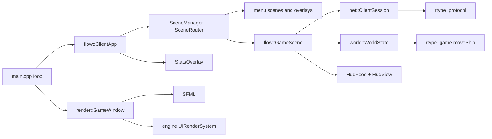
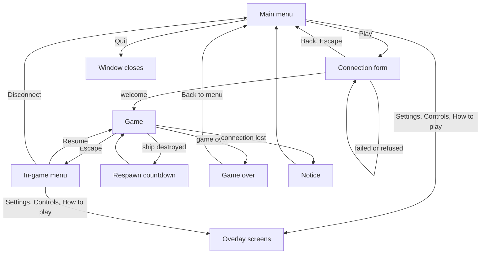

# Client

The client is split so that only one file knows the window library.



| Part | Role |
| --- | --- |
| `net::ClientSession` | UDP socket (asio), handshake, input sending (last 4 samples per datagram), reliable channel, keepalive, 5 s silence timeout. Driven by `update()` each frame, never blocks |
| `world::WorldState` | The game as the client knows it, built from the server messages. Interpolates other entities 100 ms in the past, extrapolates with the spawn velocity for at most 1 s, forgets entities silent for 2 s |
| `render::GameWindow` | The only SFML code: window scaled with black bars from a fixed 1280 x 720 space, keyboard by physical key, sprites, HUD, generated sounds |
| `flow::ClientApp` | SFML-free. Owns the scene stack and the router, creates the `ClientSession` when the form is confirmed and turns the handshake result into `ConnectionFailed` / `WelcomeReceived` |
| `flow::GameScene` | The former game loop as a scene: receive, send the inputs at the tick rate of the server, predict, HUD. Says goodbye when it exits |
| `main.cpp` | Options, window, then one loop: poll the window, `ClientApp::frame()`, draw the world (if a game runs) and the UI |

## Scene flow



In text: the client starts on the main menu. Play opens the connection form, prefilled with the
command line (host, port, name). Confirming creates the session; a refusal or a timeout is shown
in the form, a welcome starts the game. Escape in the game opens the in-game menu, which does not
pause it. Game over shows the final score and a way back to the menu. A lost connection returns
to the menu with a notice. Leaving the game always sends the goodbye. The Lobby, Room browser,
Chat and Console scenes exist in the code but are not wired: the server has no rooms or chat.

## UI layer

`GameWindow` owns the UI layer: an ECS `Registry`, an `EventBus`, the engine
`UIInteractionSystem` and `UILayoutSystem`, a `ResourceManager` (font and sprite sheet, a missing
file only removes the text or the sprite) and `engine::render::UIRenderSystem`, which draws the
widgets after the world in screen space. The window forwards the mouse, the typed text, the
navigation keys and the resize to the interaction system, and publishes `RawKeyPressed` (F3 and
the key capture of the Controls screen) and `WindowResized`. It applies `VideoSettingsChanged`,
`VolumeChanged` and `MuteChanged`. `HudView` (score, lives, stage, beam gauge, player tags and
markers above the ships) and the F3 `StatsOverlay` (frame time, rtt, entity count; loss and
traffic are not measured by the client yet) are entities of that registry.

## Prediction and reconciliation

The own ship moves at once with `rtype::game::moveShip`, the very function the server runs each
tick. Each key sample is numbered and kept. A snapshot gives the authoritative position and
`input_ack`, the last sample the server applied: the client drops the acknowledged samples, starts
from the server position and replays the others. When the server disagrees (a wall, a hit) the
ship snaps to the server position, so the server always has the last word.

## HUD feed

`HudFeed` (`client/src/Hud/HudFeed.cpp`, SFML-free) sits between the loop and the HUD models. The
loop gives it each server message; it validates the kinds and phases, tracks the last known x of
each entity and publishes the events of the `EventBus`. `HudController` then holds the score,
the lives (one lost when our ship is destroyed with reason KILLED), the stage and the beam charge,
and `VisualCueIndicator` turns shots of other players, enemy fire and kills into a label on the
left or right side of the screen. `HudView` shows the score, lives, stage and beam gauge, and
`GameWindow` still draws the cue labels, the score list, the ping and the connection banner.

## Accessibility in the game

- Player ships differ by **color and by sprite row**, and by the number shown in the score list
  (`P1` to `P4`, with a color swatch). A marker sits above each ship in the color of the player and in a shape per slot (circle,
  triangle, square, cross); the local one has a white outline.
- The HUD shows score, lives (counted on the client from the kills it is told about), level and
  ping.
- Color palettes for protanopia, deuteranopia and tritanopia, and a high contrast option, come from
  the settings (`ClientSettings`).
- Keys are remappable and use physical positions (same on QWERTY and AZERTY); auto-fire removes the
  need to hold the shoot key.
- Sounds have no information that is not also visible.

## Running

```sh
./r-type_server 4242
./r-type_client 127.0.0.1 4242 --name Alice
```

The settings file is `~/.config/r-type/settings.cfg`, written by the Settings and Controls screens.
