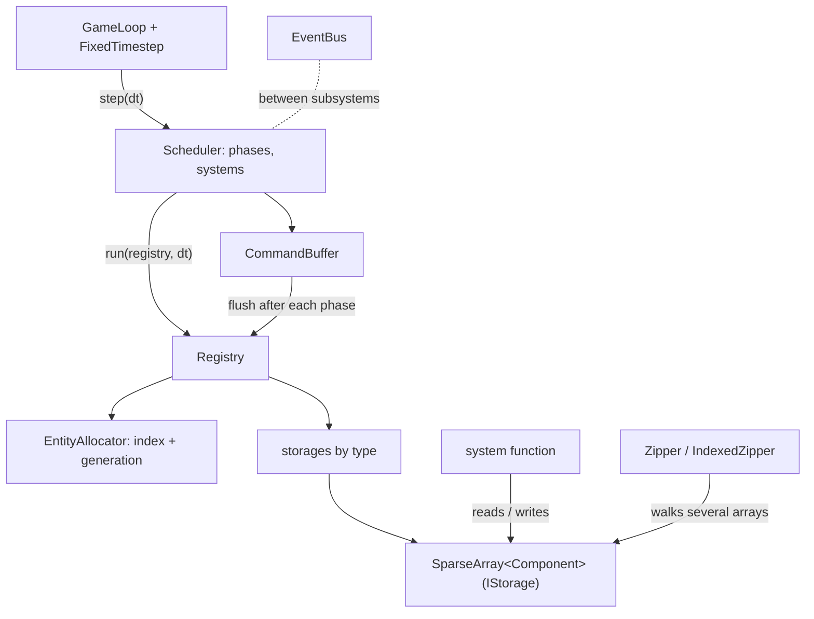
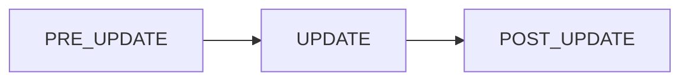
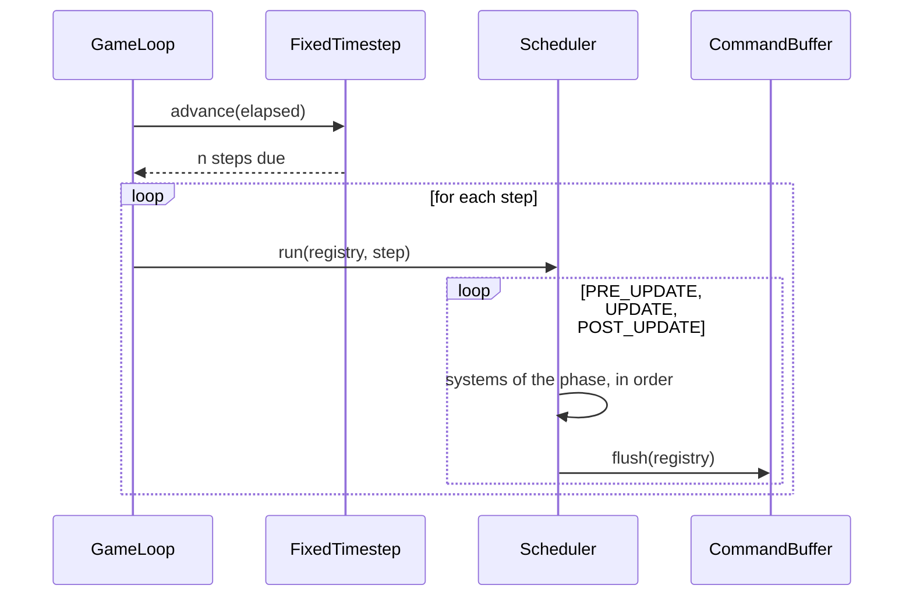

# ECS architecture

The ECS lives in `engine/` and knows nothing about R-Type: it has no component of its own.
The game adds its components and systems on top (see
[Adding a component and a system](../guides/adding-a-system.md)).

## Overview

| Layer | Role | Code |
| --- | --- | --- |
| Entities | A handle made of an index and a generation, created only by the allocator | `Entity.hpp`, `EntityAllocator.hpp` |
| Components | Plain structs, stored one array per type | `SparseArray.hpp`, `IStorage.hpp` |
| Registry | Owns the allocator and the arrays, the single entry point to create, kill and query | `Registry.hpp` |
| Iteration | Views that walk several arrays and skip entities missing a component | `Zipper.hpp`, `IndexedZipper.hpp` |
| Systems | Functions with declared read and write access, grouped in phases | `Scheduler.hpp`, `Access.hpp`, `Phase.hpp` |
| Deferred changes | Spawns, kills and component changes recorded during a phase | `CommandBuffer.hpp` |
| Time | Fixed step accumulator and the loop that drives the scheduler | `FixedTimestep.hpp`, `GameLoop.hpp` (`Core/`) |
| Communication | Typed events between subsystems | `EventBus.hpp` (`Core/`) |

All files are under `engine/include/Engine/Ecs/` (or `Core/`), the bodies are in
`engine/src/`.

## Entities

An `Entity` is 8 bytes: an index that addresses the component arrays and a generation. The
generation grows each time the index is reused, so a handle kept after its entity died is
detected instead of designating the new owner of the slot. Only `EntityAllocator` (through the
`Registry`) can create a valid handle. Freed indices are reused, most recent first.

## Components and storage

A component is any move-constructible type, usually a small struct with data only. Each type
has its own `SparseArray<Component>`: slot `i` holds the component of the entity with index
`i`, or nothing. The `Registry` keeps the arrays in a table keyed by type, behind the
`IStorage` interface so that killing an entity can erase it from every array without knowing
their types.

Rules of the registry (see [decisions](../decisions.md)):

- A component type must be registered with `registerComponent<C>()` before first use,
  otherwise the call throws `std::logic_error`.
- A stale handle is never an error: the operation does nothing and tells it through its
  return value (`nullptr`, `false`).

## Iteration

`makeZipper(a, b)` returns a view that yields, for each entity owning every listed component,
a tuple of references. `makeIndexedZipper` also yields the entity index first. Declare an array
`const` to get read-only references. The view keeps pointers to the arrays: spawning an entity
may reallocate them, so do not spawn or kill while iterating.

## Systems and phases

A system is a function run by the `Scheduler`. It is registered in one of three phases, which
always run in this order and carry no gameplay meaning of their own:

Inside a phase, systems run in registration order: there is no dependency graph. Each system
declares the components it reads and writes (`Access`), which is used to report conflicting
pairs with `findConflicts()`; conflicts are reported, not rejected, since systems run one
after the other.

The usual form is typed: `addSystem<Position, const Velocity>(name, phase, function)`. The
function is called once per matching entity as
`function(entity, position, velocity, commands, deltaTime)`. A raw form,
`addSystem(name, phase, access, function)`, gives the system the whole `Registry` once per
frame.

## Command buffer

Systems must not change the structure of the world while the scheduler iterates. They record
`spawn`, `kill`, `add`, `emplace` and `remove` commands in the `CommandBuffer` they receive.
The scheduler applies them after the last system of each phase, in recording order, so the
next phase sees the changes. A spawn takes a callback that receives the new handle when the
command is applied. If a system throws, the commands not yet applied are discarded.

## One frame

`GameLoop` reads an injected clock, asks `FixedTimestep` how many steps are due (at most a
configured maximum, the rest is dropped) and calls the step callback once per step with the
fixed duration. The loop does not know the scheduler: the callback calls `Scheduler::run`.
`alpha()` gives the leftover fraction of a step, for interpolation when rendering.

## Pitfalls

- Never spawn or kill entities while iterating a component array. Use the command buffer.
- Never keep a reference to a component across a spawn: the array may reallocate.
- The `Registry` is not thread-safe. It belongs to the thread that runs the game loop.

## Costs

The measured cost of iteration, spawn, kill, commands and a scheduler run is in the
[comparative study](../comparative-study.md#8-ecs-measurements).
