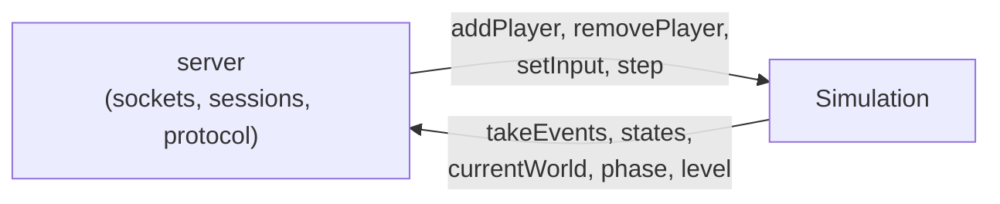
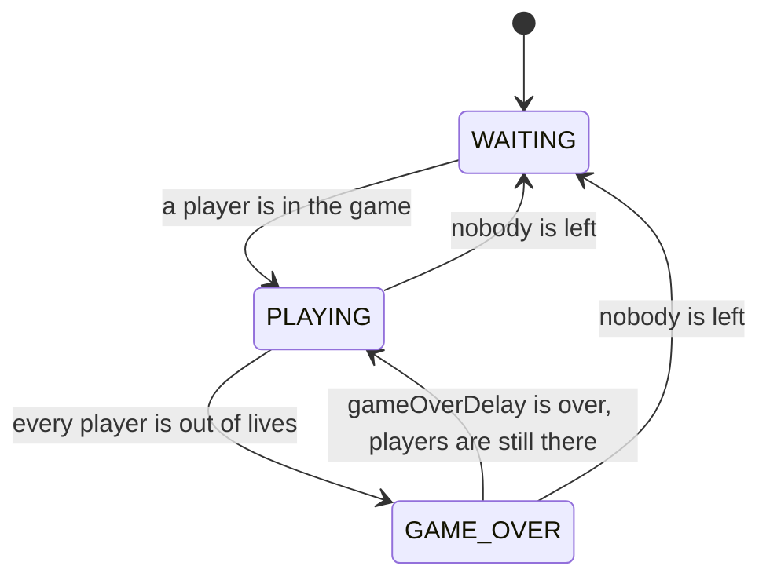

# Game simulation

The `game` library (`rtype_game`) holds the whole R-Type world: ships, missiles, enemies,
collisions, score, lives and the phases of a game. The server owns one `Simulation` and
steps it once per tick. The library knows nothing about the network: no socket, packet or
client id. Players are **slots** (0 to `maxPlayers - 1`), the inputs are the protocol
`keys` byte, and the outputs are plain C++ structs.

The `Simulation` is used by the simulation thread only, so it needs no lock. It never reads
the clock: `step()` always advances `1 / tickRate` second, so the same rules, seed and inputs
give the same game.

## The tick

The systems run in the engine `Scheduler`, phase after phase. Inside a phase they run in
registration order. The `CommandBuffer` is flushed at the end of each phase, so what a system
spawns or kills is visible to the next phase.

| Phase | System | Job |
|---|---|---|
| `PRE_UPDATE` | `game-state` | Moves the game between its phases (see below) |
| | `respawn` | Brings a dead player back after `respawnDelay` |
| | `input` | Held keys to velocity, fire cooldown, player missiles |
| | `spawn` | Creates the enemies while the game is `PLAYING` |
| `UPDATE` | `enemy-ai` | Enemy patterns and shots |
| | `movement` | `position += velocity * dt` |
| | `ship-bounds` | Keeps the player ships inside the world |
| | `collision` | Overlaps between the two teams |
| | `damage` | Health, deaths, score, lives |
| `POST_UPDATE` | `bounds` | Destroys what left the screen |

## Phases of a game

The phase is the `game_state.phase` of the protocol. Only the `game-state` system and the
code that ends a game (`checkGameOver`) change it, always through `setPhase`, which emits one
`GameStateEvent`.

### Decisions

| Question | Decision |
|---|---|
| When does `WAITING` become `PLAYING`? | On the first tick after the first player is added. There is no start delay: the game is an arcade game and a lobby belongs to the server. |
| When does a game end? | When every player present has no ship and no life left (`GAME_OVER`). A player who leaves is not counted. |
| What happens after `GAME_OVER`? | The final state stays for `gameOverDelay` seconds (5 by default) so the clients can show the results. Then a **new game starts with the players still there**. If nobody is left, the phase goes back to `WAITING` at once. |
| Can the game be left in `GAME_OVER`? | Yes: `gameOverDelay = 0` never starts a new game, the state stays until every player has left. |
| What if everybody leaves during `PLAYING`? | The game goes back to `WAITING` and the world is cleared, so the next player does not find a half-played level. |
| What if a player joins during `GAME_OVER`? | The player gets a ship at once and is part of the next game. No enemy appears until then. |

Starting or stopping a game **resets the world**, in this order:

1. every enemy and missile is destroyed (`DestroyEvent`, reason `LEFT_SCREEN`);
2. every player present gets `lives` lives, a score of 0 (a `ScoreEvent` if it was not 0) and
   a ship if it has none (`SpawnEvent`);
3. the level goes back to 1 and the waves restart;
4. the new phase is announced (`GameStateEvent`).

## Events

`takeEvents()` returns the events since the last call, **in the order they happened**, and
clears them. Inside a tick, the order follows the systems. What a client can rely on:

- a `SpawnEvent` always comes before any other event about the same `net_id`;
- a kill gives the `DestroyEvent` first, then the `ScoreEvent` of the killer;
- a level-up (`GameStateEvent` with the same phase and a higher level) comes right after the
  `SpawnEvent` of the enemy that triggered it;
- when a game starts, the ships of `addPlayer` come first, then the `GameStateEvent`
  (`PLAYING`).

A `net_id` is reused only after every other id was used, see `NetIdAllocator`.

## Queries

| Function | Use |
|---|---|
| `states()` | Position of every living entity, for the snapshots. |
| `currentWorld()` | A `SpawnEvent` for every living entity, for a client that joins late (protocol 8.1). Same order as `states()`. |
| `phase()`, `level()` | What to send in a `game_state` to a client that joins late. |

The scores are only reported through `ScoreEvent`: a server that wants to tell a late joiner
the scores of the others has to keep the last total of each player.

## Rules

`GameRules` holds every number of the game: tick rate, size of the world, speeds, fire
intervals, `lives`, `respawnDelay`, `enemySpawnInterval` (0 for no enemies), `enemyScore`,
`enemiesPerLevel` (0 for no level-up) and `gameOverDelay`. The server builds it from its own
configuration, and `simulationHz` must equal `tickRate`.
