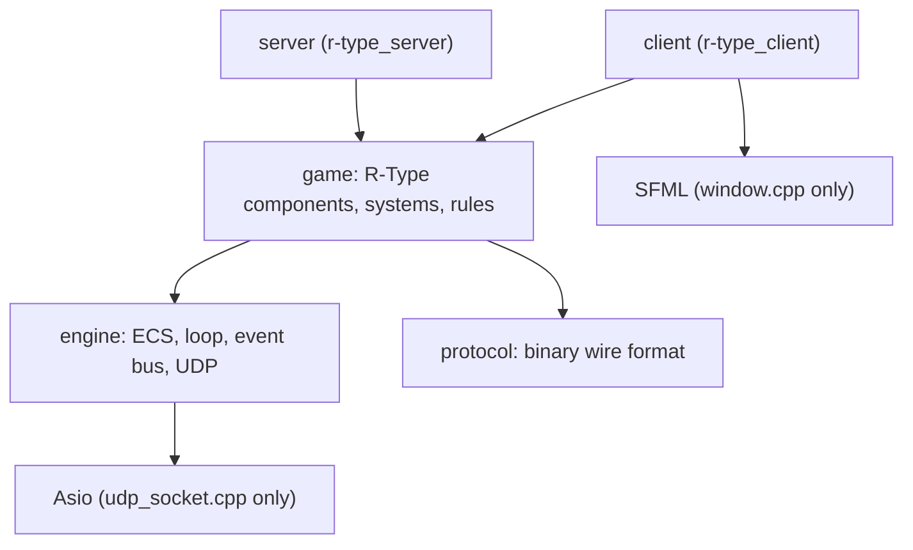
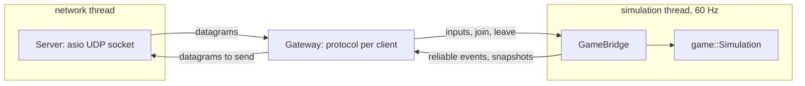

# Architecture overview

## Layers

Dependencies only point downwards. `engine` knows nothing about R-Type, which keeps it
reusable (a second sample game is planned for Part 2).

| Module | Content | Does NOT know about |
| --- | --- | --- |
| `engine/ecs` | `Registry`, `SparseArray`, `Zipper` / `IndexedZipper`, `Scheduler`, `CommandBuffer` | the game, rendering, network |
| `engine/core` | `FixedTimestep`, `GameLoop`, `EventBus`, `Vec2`, `SceneManager` | the game |
| `engine/net` | `udp_socket` (Asio hidden behind a pimpl), `udp_worker` (I/O thread) | the protocol |
| `protocol` | message structs, `encode` / `decode`, bounds-checked buffers | sockets |
| `game` | components, constants, factories, gameplay systems | sockets, windows |
| `server` | sessions, authoritative simulation, broadcasting | rendering |
| `client` | input, local mirror of the world, rendering | gameplay rules |

## ECS in a nutshell

- An **entity** is a handle made of an index and a generation, created only by the `Registry`.
- A **component** is plain data, stored in a `SparseArray<Component>` (one slot per entity).
- A **system** is a function registered in a phase of the `Scheduler`. It declares the
  components it reads and writes and records its structural changes in a `CommandBuffer`.
  `Zipper` / `IndexedZipper` iterate several arrays at once and skip entities that miss a
  component.

Rendering only needs a position and a tag; it never sees health or velocity. That is the
decoupling the subject asks for. The details are in the [ECS architecture](ecs.md).

## Server

### Server wiring

Three classes, each with one job:

- **`Gateway`** (`server/`): the protocol of every client (handshake, `Connection`, reliable
  channel, flood limits, liveness). It is thread-safe (one mutex) and opens no socket: datagrams
  and the clock are passed in, and it hands datagrams back through a callback.
- **`Server`**: owns the Asio UDP socket and two `std::jthread`s, a network thread and a
  simulation thread. It is the only class that touches the socket.
- **`GameBridge`**: connects the `rtype::game::Simulation` to protocol messages. Each client has
  an `InputQueue` that releases **one input per tick** and remembers the last one applied
  (`input_ack`). Simulation events (spawn, destroy, score, game state) are sent as **reliable**
  records to every client, and a **snapshot at 20 Hz** (`SNAPSHOT_RATE`) carries the positions
  and the `input_ack` of each client. A client that joins first receives the current world.

Text equivalent: the network thread reads datagrams and gives them to the `Gateway`, which
validates them and passes inputs and joins to the `GameBridge`. The simulation thread steps the
`Simulation` once per tick, and the `GameBridge` returns the events and snapshots to the
`Gateway`, which builds the datagrams that the network thread sends. The client side is in the
[client architecture](client.md), and the mapping of the protocol to code is in the
[protocol implementation](../protocol/implementation.md).

### Threads

- The **network thread** owns the socket. It reads at most 256 datagrams per pass, hands them
  to the `Gateway`, drops clients silent for too long and sends the outgoing datagrams. The
  message queues are bounded, so a flood of packets cannot grow memory.
- The **simulation thread** runs at a fixed 60 Hz (clock-driven, never tied to CPU speed):
  it applies one queued input per client, steps the simulation, broadcasts the events and,
  every third tick, the snapshots.
- The server is **authoritative**: clients only send their pressed keys.

## Client

See the [client architecture](client.md). In short: a fixed-step loop reads the keys, sends
them, predicts the own ship with the same `moveShip` as the server, reconciles on each
snapshot with `input_ack`, interpolates the other entities and draws. SFML is confined to the
game window and the engine render library, which the server never links.

## Known limits (Part 2, Advanced Networking)

- Snapshots are absolute: no delta compression, no payload compression.
- One game per server, no lobbies or rooms, IPv4 only, no authentication.
- No lag compensation on the server.
- Sound effects are generated and only played for shots and explosions.
