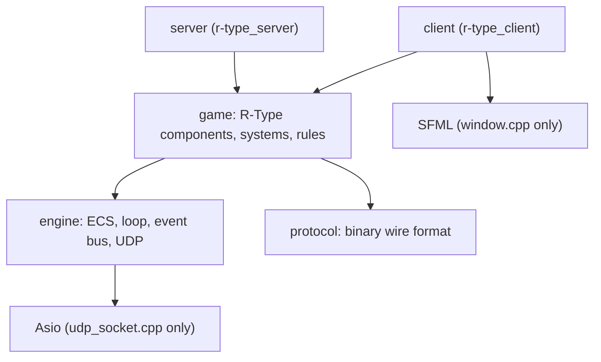
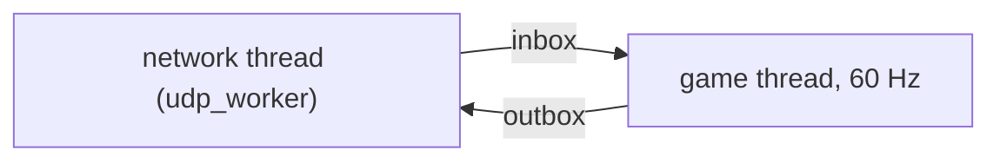

# Architecture overview

## Layers

Dependencies only point downwards. `engine` knows nothing about R-Type, which keeps it
reusable (a second sample game is planned for Part 2).

| Module | Content | Does NOT know about |
| --- | --- | --- |
| `engine/ecs` | `Registry`, `SparseArray`, `Zipper` / `IndexedZipper`, `Scheduler`, `CommandBuffer` | the game, rendering, network |
| `engine/core` | `FixedTimestep`, `GameLoop`, `EventBus`, `Vec2` | the game |
| `engine/net` | `udp_socket` (Asio hidden behind a pimpl), `udp_worker` (I/O thread) | the protocol |
| `protocol` | message structs, `encode` / `decode`, bounds-checked buffers | sockets |
| `game` | components, constants, factories, gameplay systems | sockets, windows |
| `server` | sessions, authoritative simulation, broadcasting | rendering |
| `client` | input, local mirror of the world, rendering | gameplay rules |

## ECS in a nutshell

- An **entity** is a handle made of an index and a generation, created only by the `Registry`.
- A **component** is plain data, stored in a `SparseArray<Component>` (one slot per entity).
- A **system** is a function registered in a phase of the `Scheduler`. It declares the
  components it reads and writes and records its structural changes in a `CommandBuffer`.
  `Zipper` / `IndexedZipper` iterate several arrays at once and skip entities that miss a
  component.

Rendering only needs a position and a tag; it never sees health or velocity. That is the
decoupling the subject asks for. The details are in the [ECS architecture](ecs.md).

## Server

- The **network thread** owns the socket. It only moves datagrams between the socket and two
  bounded queues. A flood of packets fills the queue and gets dropped, it cannot grow memory.
- The **game thread** runs at a fixed 60 Hz (`fixed_timestep_loop`, clock-driven):
  1. decode inbound datagrams (anything malformed is dropped and counted),
  2. drop clients silent for 5 s (crash detection) and tell the others (`player_left`),
  3. fire missiles, spawn Bydos, run systems (control, movement, clamp),
  4. collisions and off-screen cleanup, broadcast `entity_destroy` for the dead,
  5. broadcast `entity_state` snapshots.
- The server is **authoritative**: clients only send their pressed keys.

## Client

- Main thread: poll window events, pump network, send input, render. Star-field scrolling
  uses the real elapsed time (`stopwatch`), never the frame rate.
- It keeps a local `registry` that mirrors the server's entities (created on first sight,
  updated by snapshots, removed on `entity_destroy`, or after 1 s of silence in case a destroy
  packet was lost).
- SFML is confined to `client/src/window.cpp`.

## Known limits of Part 1 (candidates for Part 2)

- Snapshots are sent at the full tick rate with no delta compression or interpolation.
- Spawn / destroy messages are not acknowledged (UDP): the client self-heals by creating
  unknown entities lazily and pruning silent ones, but there is no real reliability layer.
- One game per server, IPv4 only, no authentication.
- No enemy missiles, power-ups or sound yet.
