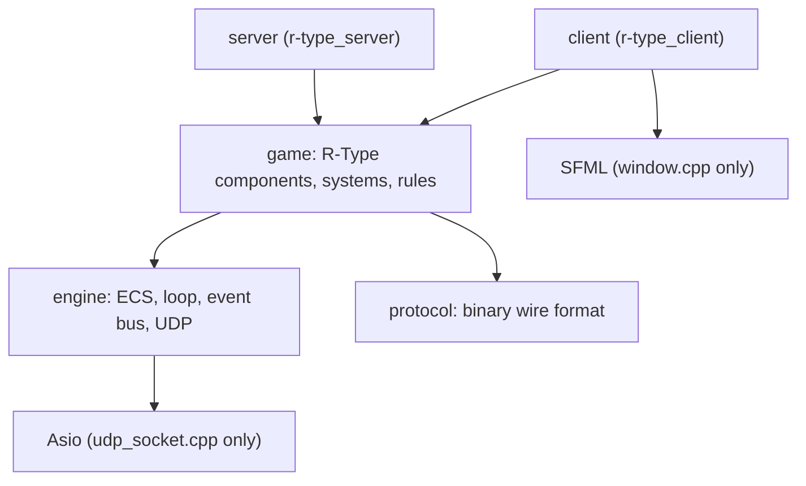
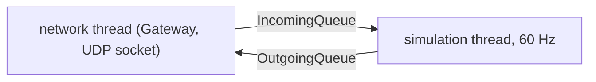

# Architecture overview

## Layers

Dependencies only point downwards. `engine` knows nothing about R-Type, which keeps it
reusable (a second sample game is planned for Part 2).

| Module | Content | Does NOT know about |
| --- | --- | --- |
| `engine/ecs` | `Registry`, `SparseArray`, `Zipper` / `IndexedZipper`, `Scheduler`, `CommandBuffer` | the game, rendering, network |
| `engine/core` | `FixedTimestep`, `GameLoop`, `EventBus`, `Vec2`, `SceneManager` | the game |
| `engine/net` | `udp_socket` (Asio hidden behind a pimpl), `udp_worker` (I/O thread) | the protocol |
| `protocol` | message structs, `encode` / `decode`, bounds-checked buffers | sockets |
| `game` | components, constants, factories, gameplay systems | sockets, windows |
| `server` | sessions, authoritative simulation, broadcasting | rendering |
| `client` | input, local mirror of the world, rendering | gameplay rules |

## ECS in a nutshell

- An **entity** is a handle made of an index and a generation, created only by the `Registry`.
- A **component** is plain data, stored in a `SparseArray<Component>` (one slot per entity).
- A **system** is a function registered in a phase of the `Scheduler`. It declares the
  components it reads and writes and records its structural changes in a `CommandBuffer`.
  `Zipper` / `IndexedZipper` iterate several arrays at once and skip entities that miss a
  component.

Rendering only needs a position and a tag; it never sees health or velocity. That is the
decoupling the subject asks for. The details are in the [ECS architecture](ecs.md).

## Server

`Server` (`server/src/Server.cpp`) starts two `std::jthread`s that only share two bounded
`MessageQueue`s (`IncomingQueue`, `OutgoingQueue`, see `ServerMessage.hpp`). A full queue
refuses the message, so a flood of packets cannot grow memory.

- The **network thread** owns the non-blocking UDP socket and the `Gateway`, which runs the
  [protocol](../protocol/implementation.md) (handshake, one `Connection` per client, rate
  limit). Every 2 ms it:
    1. reads up to 256 datagrams and hands each one to `Gateway::onDatagram`. A payload that
       fails `PacketReader::isValid` is dropped and counted. A `GOODBYE` becomes a disconnect
       request, anything else marks the client active in `ClientActivity` and goes to the
       incoming queue,
    2. disconnects the clients silent for longer than `inactivityTimeout` (5 s) and queues a
       disconnect request for each,
    3. moves the outgoing queue into the `Gateway`, then calls `Gateway::flush` (pending
       messages, retransmissions, acknowledgements, keepalives).
- The **simulation thread** owns the `game::Simulation` and `PlayerSessions` (4 player slots).
  It runs a fixed timestep loop written in `Server::runSimulationLoop` (it does not use the
  engine `GameLoop` or `FixedTimestep`). One iteration:
    1. adds the elapsed time to an accumulator, capped at `maxFrameTime` (250 ms),
    2. drains the incoming queue: a `HELLO` gives the client a slot (`PlayerSessions::join`),
       a disconnect request frees it and queues a `player_left` for the other players,
    3. calls `Simulation::step()` once per full timestep in the accumulator,
    4. sleeps until the next timestep.
- The server is **authoritative**: clients only send their pressed keys.
- `SIGINT` / `SIGTERM` stop the server: `Server::shutdown` stops the network thread, then the
  simulation thread, and the `Gateway` sends a `GOODBYE` (`SHUTDOWN`) to every client.

Main `ServerConfig` options:

| Option | Default | Meaning |
| --- | --- | --- |
| `port` | 4242 | UDP port, 0 picks a free one |
| `simulationHz` | 60 | Ticks per second, clamped to 1..240 |
| `seed` | 0 | Seed of the enemy waves |
| `maxFrameTime` | 250 ms | Longest time simulated in one iteration |
| `maxQueueCapacity` | 1024 | Messages kept by each queue |
| `inactivityTimeout` | 5000 ms | Silence before a client is disconnected |

`main.cpp` uses the defaults: there are no command-line options yet.

## Client

- Main thread: poll window events, pump network, send input, render. Star-field scrolling
  uses the real elapsed time (`stopwatch`), never the frame rate.
- It keeps a local `registry` that mirrors the server's entities (created on first sight,
  updated by snapshots, removed on `entity_destroy`, or after 1 s of silence in case a destroy
  packet was lost).
- SFML is confined to `client/src/window.cpp` and to the engine render library
  (`rtype::engine_render`, see [UI](ui.md#rendering)), which the server never links.

## Known limits of Part 1 (candidates for Part 2)

- Inputs are not applied to the simulation and players get no ship yet (#141).
- Game events and snapshots are not encoded nor sent yet (#142).
- No command-line options: the server always listens on UDP port 4242.
- One game per server, IPv4 only, no authentication.
- No power-ups or sound yet.
