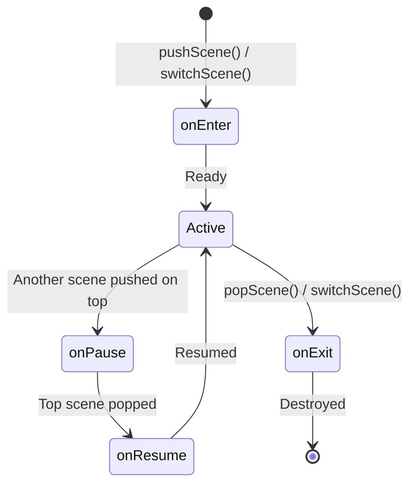
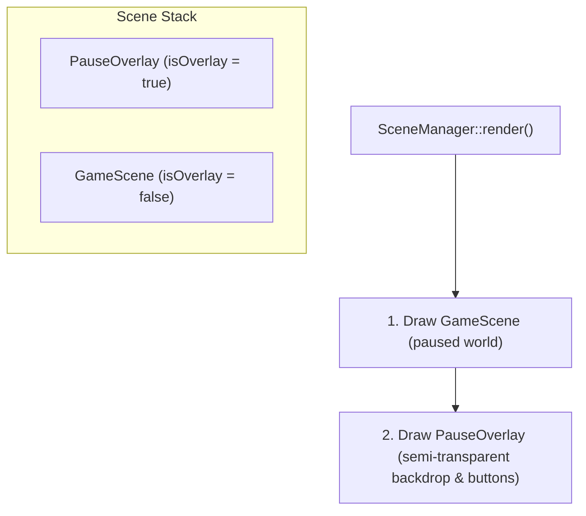

# Scenes and state machine

The client application transitions between multiple states (e.g., Boot, Main Menu, Lobby,
Game session, Settings) and displays modal overlays (Pause menu, Game Over).

To keep the game engine decoupled and reusable, the state machine is implemented in
`engine/core` via `IScene` and `SceneManager`. It knows nothing about R-Type specific
scenes, which live in `client/`.

## Scene lifecycle

Every screen or modal overlay implements the `IScene` interface:

| Method | When called |
| --- | --- |
| `onEnter()` | When the scene becomes the active top scene for the first time. |
| `onExit()` | When the scene is removed from the stack and about to be destroyed. |
| `onPause()` | When a new scene or overlay is pushed on top of this scene. |
| `onResume()` | When the scene on top is popped and this scene resumes as active. |
| `update(dt)` | Ticked each frame for the top scene with delta time in seconds. |
| `render()` | Called to draw the scene. |
| `handleInput()` | Dispatches input events to the active top scene. |
| `isOverlay()` | Returns `true` if this is a transparent overlay (e.g. Pause menu). |

## Scene stack and overlays

`SceneManager` owns a stack of scenes (`std::vector<std::unique_ptr<IScene>>`):

- **Pushing a scene (`pushScene`)**: Pauses the current scene (`onPause()`) and pushes the
  new one (`onEnter()`).
- **Popping a scene (`popScene`)**: Exits the top scene (`onExit()`), destroys it, and
  resumes the underlying scene (`onResume()`).
- **Switching a scene (`switchScene`)**: Exits all existing scenes on the stack and installs
  the new scene as the single active base scene.

### Transparent overlay rendering

When the top scene is an overlay (`isOverlay() == true`), `SceneManager::render()` iterates
from the lowest visible base scene up to the top scene. For example, when `PauseOverlay`
is pushed on top of `GameScene`:

While both scenes are rendered, **only the top scene (`PauseOverlay`) receives `update()`
and `handleInput()`**, ensuring that game simulation is halted and player keystrokes do not
fire missiles while navigating the pause menu.

