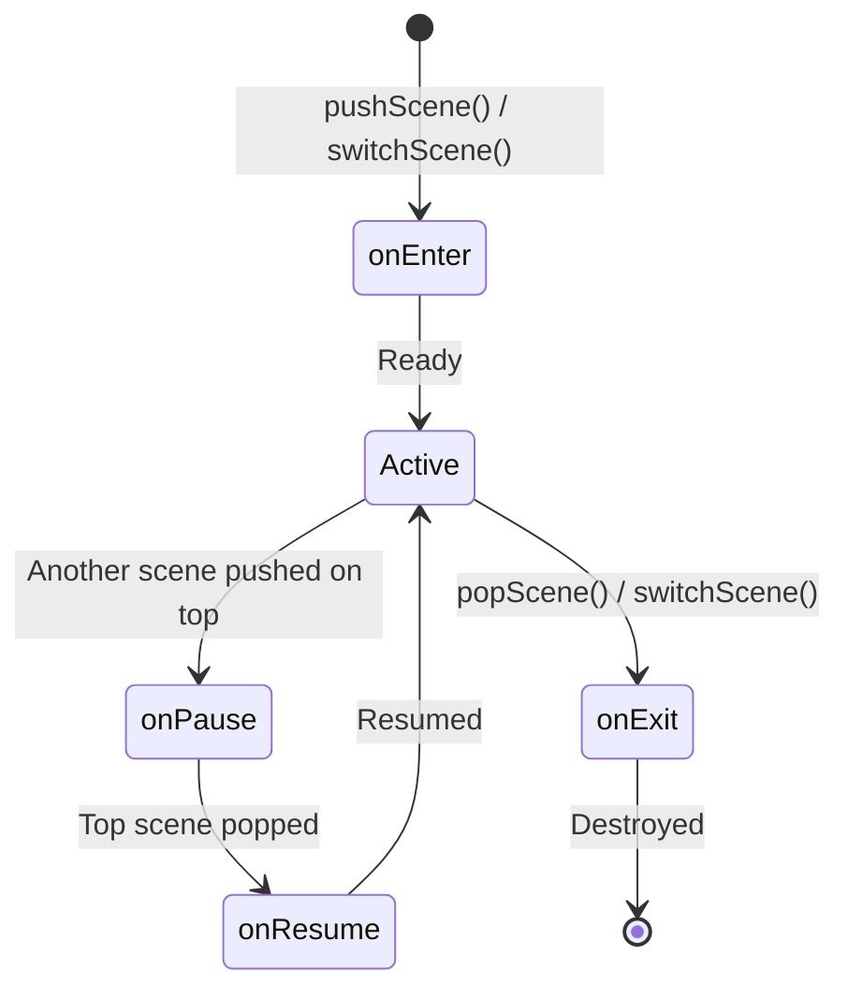
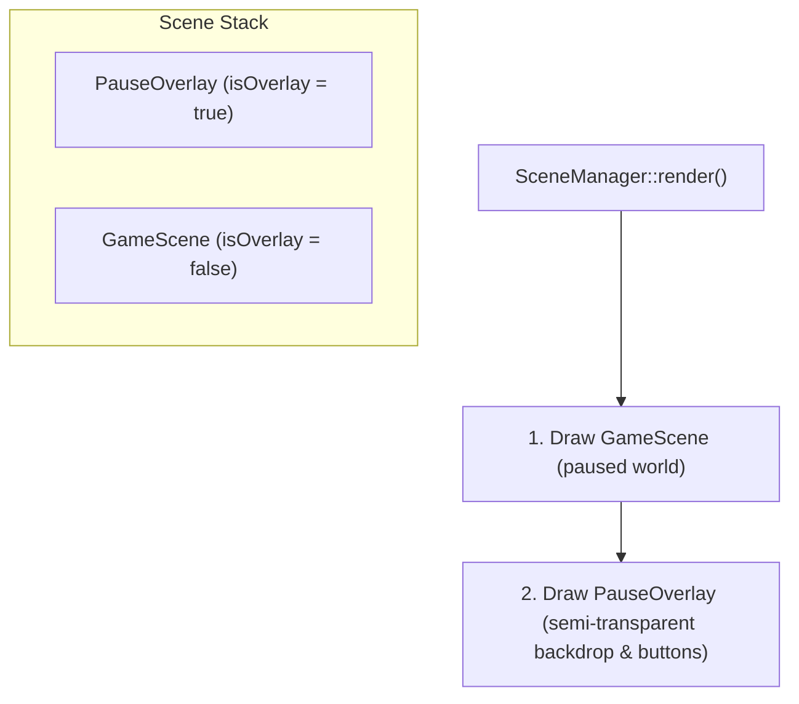

# Scenes and state machine

The client application transitions between multiple states (e.g., Boot, Main Menu, Lobby,
Game session, Settings) and displays modal overlays (Pause menu, Game Over).

To keep the game engine decoupled and reusable, the state machine is implemented in
`engine/core` via `IScene` and `SceneManager`. It knows nothing about R-Type specific
scenes, which live in `client/`.

## Scene lifecycle

Every screen or modal overlay implements the `IScene` interface:



| Method | When called |
| --- | --- |
| `onEnter()` | When the scene becomes the active top scene for the first time. |
| `onExit()` | When the scene is removed from the stack and about to be destroyed. |
| `onPause()` | When a new scene or overlay is pushed on top of this scene. |
| `onResume()` | When the scene on top is popped and this scene resumes as active. |
| `update(dt)` | Ticked each frame for the top scene with delta time in seconds. |
| `render()` | Called to draw the scene. |
| `handleInput()` | Dispatches input events to the active top scene. |
| `isOverlay()` | Returns `true` if this is a transparent overlay (e.g. Pause menu). |

## Scene stack and overlays

`SceneManager` owns a stack of scenes (`std::vector<std::unique_ptr<IScene>>`):

- **Pushing a scene (`pushScene`)**: Pauses the current scene (`onPause()`) and pushes the
  new one (`onEnter()`).
- **Popping a scene (`popScene`)**: Exits the top scene (`onExit()`), destroys it, and
  resumes the underlying scene (`onResume()`).
- **Switching a scene (`switchScene`)**: Exits all existing scenes on the stack and installs
  the new scene as the single active base scene.

### Transparent overlay rendering

When the top scene is an overlay (`isOverlay() == true`), `SceneManager::render()` iterates
from the lowest visible base scene up to the top scene. For example, when `PauseOverlay`
is pushed on top of `GameScene`:



While both scenes are rendered, **only the top scene receives `handleInput()`**, so player
keystrokes do not fire missiles while navigating a menu. By default only the top scene receives
`update()` too. An overlay whose `updatesSceneBelow()` returns `true` also keeps the scene below
it updating, first, as a server-authoritative game does behind its menu.

## UI scenes and navigation

Two generic helpers build screens for any game. They know nothing about R-Type:

- **`engine::ecs::UIScene`** (no SFML) is the base of a screen made only of UI components. It
  creates the widgets and listeners on `onEnter()` / `onResume()` (the `activate()` you write)
  and removes them on `onExit()` / `onPause()`. `handleInput()` applies the input the window code
  gave to the shared `UIInteractionSystem`. `render()` does nothing, the game's `UIRenderSystem`
  draws the registry. The look of the buttons comes from `UISceneContext::buttonStyle`.
- **`engine::core::SceneRouter<Route>`** changes screen. A scene publishes
  `NavigationRequested<Route>`, and `apply()` switches between two frames: switching at once would
  destroy the scene while its own listener runs. `Route` is chosen by the game, usually an enum. A
  route with no scene yet is ignored. `OverlayRequested<Route>` and `OverlayCloseRequested` push
  and close overlays the same way, and `OverlaysClearRequested` closes all of them. `QuitRequested` sets `quitRequested()`.
- **`engine::ecs::UIOverlay`** is a `UIScene` drawn above the others: its widgets get a higher
  z-index, `addBackdrop()` covers the window, and the scene below keeps updating unless told not to.

The main loop runs, in order:

```cpp
scenes.handleInput();
scenes.update(dt);
router.apply();
if (router.quitRequested())
    stop();
```

## R-Type menu scenes

`MainMenuScene` and `ConnectScene` live in `client/` and derive from `UIScene`.
`client::scenes::SceneRoute` lists the screens of the game, and `makeMenuContext()` gives the
scenes the R-Type button colors.

### Overlays above the game

`GameOverlays` decides what is above the game, from events only (`client/`). There is at most one
overlay. Game over wins over the in-game menu, which wins over the respawn countdown:

| Overlay | Opens on | Closes on |
| --- | --- | --- |
| `InGameMenuOverlay` | `Escape` (`UICancelEvent`) | `Escape`, "Resume"; "Disconnect" leaves the game |
| `RespawnOverlay` | our ship in `EntityDestroyed` with reason `KILLED` | our ship in `EntitySpawned` |
| `GameOverOverlay` | `GameStateChanged` with phase `GAME_OVER` | "Back to menu" leaves the game |

The menu publishes `InGameMenuOpened` / `InGameMenuClosed`; leaving publishes
`DisconnectRequested`. The countdown keeps running under the menu. The server is never paused.

### Settings

`SettingsScene` is an overlay opened from the main menu and from the in-game menu. It edits
`ClientSettings` and publishes the changes, without applying them: `VolumeChanged`, `MuteChanged`
and `VideoSettingsChanged` are for the audio and window code. Only the UI scale is applied by the
screen itself, on `UILayoutSystem`.

`SettingsStore` keeps the values in a `key=value` file (`settings.cfg` in the user data directory),
written when the screen exits. A missing or broken file gives usable settings: each invalid line is
ignored and the default stays. At startup the client calls `store.load()` and applies the values:

```cpp
layout.setScale(static_cast<float>(store.settings().uiScalePercent) / 100.0f);
```

### Talking to the network layer

`ConnectScene` never calls network code. All the messages are `EventBus` events, declared in
`Client/Events/ConnectionEvents.hpp` and `GameEvents.hpp`:

| Event | Direction | Effect |
| --- | --- | --- |
| `ConnectRequested { host, port, nickname }` | scene → network | The form was valid; it is locked. |
| `ConnectCancelled` | scene → network | The player left during a connection. |
| `ConnectionStarted { host, port }` | network → scene | Shows "Connecting to host:port...". |
| `WelcomeReceived` | network → scene | Asks for the game scene. |
| `ConnectionFailed { reason }` | network → scene | Shows a message and unlocks the form. |

`ConnectionFailure` uses the protocol `reject` values, plus `TIMEOUT` and `INVALID_ADDRESS`
found by the client. An unknown reason still shows a generic message. The checks and the texts
are pure functions in `Client/Scenes/ConnectForm.hpp`.
