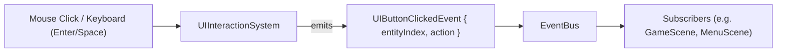

# UI and layout system

In contrast to gameplay entities (spaceships, bullets, Bydos monsters) that exist in
world coordinates and scroll horizontally with the starfield, user interface elements
(HUD, menus, dialogues, buttons) live in viewport screen-space.

To remain responsive across different window resolutions, aspect ratios, and resizing
events, the UI framework provides the `UITransform` component and `UILayoutSystem`.
Interactive widgets are handled via `UIButton` and `UIInteractionSystem`.

## Anchoring model

`UIAnchor` provides 9 attachment points across the screen viewport:

```
TOP_LEFT (0,0) ----------- TOP_CENTER (W/2,0) ----------- TOP_RIGHT (W,0)
     |                           |                              |
CENTER_LEFT (0,H/2) ------    CENTER (W/2,H/2)    ------ CENTER_RIGHT (W,H/2)
     |                           |                              |
BOTTOM_LEFT (0,H) -------- BOTTOM_CENTER (W/2,H) -------- BOTTOM_RIGHT (W,H)
```

- **`offset`**: 2D pixel offset relative to the chosen anchor.
- **`size`**: Dimensions of the element (in absolute pixels or normalized relative to
  viewport dimensions via `normalizedSize`).
- **`zIndex`**: Layer ordering (higher z-index values draw on top of lower ones).
- **`actualBounds`**: The resolved 2D rectangle (`x, y, width, height`) computed by
  `UILayoutSystem`.

## UILayoutSystem

`UILayoutSystem` resolves the final screen bounds for all entities with a `UITransform`:

```cpp
#include "Engine/Ecs/Components/UITransform.hpp"
#include "Engine/Ecs/Systems/UILayoutSystem.hpp"

// Setup layout system with initial window resolution:
engine::ecs::UILayoutSystem layoutSystem(1280.0f, 720.0f);

// Create a HUD element anchored at the bottom-center of the screen:
engine::ecs::UITransform hudTransform;
hudTransform.anchor = engine::ecs::UIAnchor::BOTTOM_CENTER;
hudTransform.size = {800.0f, 60.0f};
hudTransform.offset = {0.0f, -20.0f}; // 20 pixels above the bottom edge

// When the window is resized to 1920x1080:
layoutSystem.setResolution(1920.0f, 1080.0f);
layoutSystem.update(transforms);

// hudTransform.actualBounds is now: {560.0f, 1000.0f, 800.0f, 60.0f}
// The element remains centered and 20px above the bottom without drift.
```

## Interactive buttons & EventBus decoupling

Per subject decoupling requirements, the UI interaction layer never directly invokes
gameplay rules or network calls. Instead, widget clicks emit typed events on the engine's
`EventBus`.



### Button states

A `UIButton` cycles through 4 states:
- **`NORMAL`**: Idle state.
- **`HOVERED`**: Mouse is currently over the button's `actualBounds`.
- **`PRESSED`**: Mouse button is currently held down over the button.
- **`DISABLED`**: Non-interactive; ignores mouse clicks and keyboard focus.

### Accessibility: Keyboard and Gamepad navigation

For accessibility compliance, menus can be fully navigated without a mouse:
- `Tab` / `Down` / `Right`: Advances focus (`isFocused = true`) to the next enabled button.
- `Up` / `Left`: Moves focus to the previous enabled button.
- `Enter` / `Space` / Gamepad A: Activates the focused button, emitting `UIButtonClickedEvent`.

## Rendering

UI drawing lives in a separate library, `rtype::engine_render`, because it needs SFML. It
is only built with the client (`RTYPE_BUILD_CLIENT`), so the server keeps linking the
SFML-free `rtype::engine`. The components themselves stay plain data in `rtype::engine`.

| Component | Draws |
| --- | --- |
| `UIPanel` | A plain colored rectangle, or a texture (`textureId`, optional `textureRect`) stretched (`STRETCH`) or 9-sliced (`NINE_SLICE`, unscaled `borders`). |
| `UIProgressBar` | A background, then a fill of `(value - min) / (max - min)`, clamped to [0, 1], left to right (`HORIZONTAL`) or bottom to top (`VERTICAL`). |
| `UIText` | A UTF-8 string in the font `fontId`, aligned `LEFT`, `CENTER` or `RIGHT`, vertically centered. |

`UIRenderSystem::render()` draws every entity with a `UITransform` and at least one of these
components, inside its `actualBounds`, sorted by `zIndex` (ties keep the entity order). An
entity with several of them draws panel, then bar, then text.

### Fixed screen-space view

Before drawing, the system replaces the target view with `screenView()`, one unit per pixel
of the target, and puts the previous view back afterwards. The world camera can scroll
freely: the HUD never drifts. Keep `UILayoutSystem` at the window size
(`setResolution()` on resize) so `actualBounds` match the pixels.

```cpp
engine::resources::ResourceManager resources("assets");
engine::render::UIRenderSystem uiRenderer(resources);

window.setView(worldCamera);
// ... draw the starfield and the entities ...
uiRenderer.render(window, transforms, panels, bars, texts);
window.display();
```

### Resources

`ResourceManager` resolves ids against its asset root (`"fonts/main.ttf"`) and loads each one
at most once, through the generic `ResourceCache<T>`. A missing file returns `nullptr` and is
remembered, so it is not read again every frame. The renderer then skips the text, or
falls back to the panel color for a missing texture: a missing asset never stops a frame.
