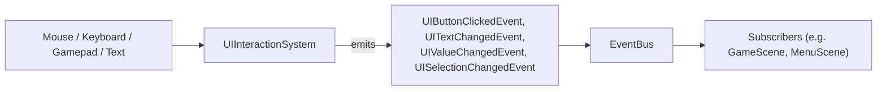

# UI and layout system

In contrast to gameplay entities (spaceships, bullets, Bydos monsters) that exist in
world coordinates and scroll horizontally with the starfield, user interface elements
(HUD, menus, dialogues, buttons) live in viewport screen-space.

To remain responsive across different window resolutions, aspect ratios, and resizing
events, the UI framework provides the `UITransform` component and `UILayoutSystem`.
Interactive widgets are handled via `UIButton` and `UIInteractionSystem`.

## Anchoring model

`UIAnchor` provides 9 attachment points across the screen viewport:

```
TOP_LEFT (0,0) ----------- TOP_CENTER (W/2,0) ----------- TOP_RIGHT (W,0)
     |                           |                              |
CENTER_LEFT (0,H/2) ------    CENTER (W/2,H/2)    ------ CENTER_RIGHT (W,H/2)
     |                           |                              |
BOTTOM_LEFT (0,H) -------- BOTTOM_CENTER (W/2,H) -------- BOTTOM_RIGHT (W,H)
```

- **`offset`**: 2D pixel offset relative to the chosen anchor.
- **`size`**: Dimensions of the element (in absolute pixels or normalized relative to
  viewport dimensions via `normalizedSize`).
- **`zIndex`**: Layer ordering (higher z-index values draw on top of lower ones).
- **`actualBounds`**: The resolved 2D rectangle (`x, y, width, height`) computed by
  `UILayoutSystem`.

## Setting up the UI in a game

The UI components are ordinary ECS components: they live in the game `Registry`, and the UI
systems run on the game `Scheduler` like any other system (see the [ECS page](ecs.md)).

```cpp
#include "Engine/Ecs/Components/UIComponents.hpp"
#include "Engine/Ecs/Systems/UIInteractionSystem.hpp"
#include "Engine/Ecs/Systems/UILayoutSystem.hpp"
#include "Engine/Render/UIRenderSystem.hpp"

engine::ecs::Registry registry;
engine::ecs::Scheduler scheduler;
engine::core::EventBus bus;

engine::ecs::registerUIComponents(registry);           // UITransform, UIButton, UIPanel, ...

engine::ecs::UILayoutSystem layout(1280.0f, 720.0f);
engine::ecs::UIInteractionSystem interaction(bus);
interaction.addTo(scheduler);                          // PRE_UPDATE: applies the queued input
layout.addTo(scheduler);                               // POST_UPDATE: resolves actualBounds

// Window events only queue input; the scheduler applies it on the next run():
interaction.onMouseMove(mouseX, mouseY);
interaction.onKeyPressed(engine::ecs::UIKey::ENTER);
layout.setResolution(newWidth, newHeight);             // on resize

scheduler.run(registry, step);
uiRenderer.render(window, registry);                   // after the world, see Rendering
```

`layout` and `interaction` must outlive the scheduler entries that `addTo()` creates. In a test,
`layout.update(registry)` and `interaction.process(registry)` do the same work without a
scheduler.

## UILayoutSystem

`UILayoutSystem` resolves the final screen bounds of every entity with a `UITransform`:

```cpp
// A HUD element anchored at the bottom-center of the screen:
const engine::ecs::Entity hud = registry.spawnEntity();
engine::ecs::UITransform transform;
transform.anchor = engine::ecs::UIAnchor::BOTTOM_CENTER;
transform.size = {800.0f, 60.0f};
transform.offset = {0.0f, -20.0f}; // 20 pixels above the bottom edge
registry.addComponent(hud, transform);

// When the window is resized to 1920x1080:
layout.setResolution(1920.0f, 1080.0f);
layout.update(registry);

// actualBounds is now {560.0f, 1000.0f, 800.0f, 60.0f}: centered, 20px above the bottom.
```

`offset` and `size` use the engine `core::Vec2`.

## Interactive buttons & EventBus decoupling

Per subject decoupling requirements, the UI interaction layer never directly invokes
gameplay rules or network calls. Instead, widget clicks emit typed events on the engine's
`EventBus`.



### Theme and shapes

`UITheme` gives colors to named roles (`UIColorRole`: text, surface, accent, gauge, player 1 to 4...).
`UIPanel`, `UIText`, `UIProgressBar` and `UIShape` can name a role, while buttons and widgets always
follow their usual ones. `UIRenderSystem::setTheme()` resolves them when drawing, so changing the
theme recolors the UI without touching a widget. The engine defines no color: a role without a color
keeps the one stored in the component, so an empty theme changes nothing.

`UITheme::options()` holds the accessibility options: `textPlates` (a solid plate behind text, except text already on a player color),
`focusThickness`, `gaugeOutline`, and `reducedMotion`, which UI code reads through
`UIScene::reducedMotion()`.

`UIGraph` draws rolling bars (frame time, latency...), newest on the right, scaled to `maxValue`
or to its largest sample.

`UIShape` draws a circle, triangle, square or cross in its bounds, so that nothing has to be told apart
by color alone.

### UI scale

`UILayoutSystem::setScale()` multiplies offsets, sizes and text sizes, for players who need a larger
interface. Normalized sizes are left alone, since they are already relative to the window, and so is
an entity with `followsUIScale = false`, whose offset is a real screen position (a tag above a ship).
The layout writes the value used in `UITransform::resolvedScale`, and `UIRenderSystem` applies it to
the text of that entity.

### Button states

A `UIButton` cycles through 4 states:
- **`NORMAL`**: Idle state.
- **`HOVERED`**: Mouse is currently over the button's `actualBounds`.
- **`PRESSED`**: Mouse button is currently held down over the button.
- **`DISABLED`**: Non-interactive; ignores mouse clicks and keyboard focus.

`UIRenderSystem` fills the button with the color of its state (`normalColor`, `hoveredColor`,
`pressedColor`, `disabledColor`). An entity that also has a `UIPanel` is drawn with the panel
instead.

### Accessibility: Keyboard and Gamepad navigation

For accessibility compliance, menus can be fully navigated without a mouse. The window code
maps the keyboard and the gamepad onto `UIKey` (the engine never sees SFML types), for example
Tab / RB to `TAB`, Shift+Tab / LB to `BACK_TAB`, the D-pad to the arrows, A to `ENTER` and B to
`ESCAPE`, and forwards typed characters with `onTextEntered()`.

- `TAB` / `BACK_TAB`: next / previous enabled widget, whatever is focused.
- The focused widget gets the other keys first (see [Widgets](#widgets)). The keys it does not
  use navigate: `Down` / `Right` next, `Up` / `Left` previous.
- `Enter` / `Space` on a focused button emits `UIButtonClickedEvent`.
- `Enter` in a text input emits `UITextSubmittedEvent`.
- `Escape`, when the focused widget does not use it, emits `UICancelEvent`.
- `discardInput()` drops the queued input, for a modal that reads the devices itself.
- A `UITextInput` with `claimsNavigationKeys` keeps `Tab`, `Back-Tab`, `Up`, `Down` and `Escape`
  while focused, and publishes them as `UITextKeyEvent` (history, completion...).

Focus rules: at most one widget is focused at a time, and clicking a widget gives it the focus.
A disabled widget (a `DISABLED` button, or `enabled = false`) is never focused: one disabled by
game code loses its focus at the next processed input, and a button disabled while it is held
down does not emit a click when it is released. While the pointer leaves a held button, the
button shows `NORMAL`; it shows `PRESSED` again when the pointer comes back.

### Widgets

Five generic widgets complete `UIButton`. Each is a component on an entity with a
`UITransform`, has `isFocused`, `enabled`, an `action` id copied into its events, and a
`UIWidgetStyle` (background, foreground, accent and focus outline colors, font, character
size). `UIRenderSystem` draws them and an outline around the focused one.

| Component | Mouse | Keys when focused | Event |
| --- | --- | --- | --- |
| `UITextInput` | click: focus, caret at the end | typed characters, `Left` / `Right`, `Home` / `End`, `Backspace`, `Del` | `UITextChangedEvent { text }` |
| `UISlider` | click or drag: value under the pointer | `Left` / `Right` one step, `Home` / `End` min / max | `UIValueChangedEvent { value }` |
| `UIToggle` | click released over it: flip | `Enter` / `Space`: flip | `UIValueChangedEvent { 1 or 0 }` |
| `UIDropdown` | click: open / close, click an option: select | closed: `Enter` / `Space` open, `Left` / `Right` change; open: `Up` / `Down`, `Enter` / `Space` select, `Escape` close | `UISelectionChangedEvent { index, label }` |
| `UIScrollList` | click a row: select, wheel: scroll | `Up` / `Down`, `Home` / `End` | `UISelectionChangedEvent { index, label }` |

- A text input keeps UTF-8 text; its `filter` (`PRINTABLE`, `ALPHANUMERIC`, `DIGITS`) and
  `maxLength` (in characters) are enforced on every typed character.
- A slider keeps its value on a multiple of `step` from `min` (`step <= 0`: continuous).
- An open dropdown draws its options below its bounds, on top of every other entity, and takes
  the clicks there before anything else. Clicking elsewhere or moving the focus closes it.
- Events are only published when the value really changes.
- The editing rules (UTF-8 caret, snapping, scrolling, row geometry) are pure functions in
  `Engine/Ecs/Systems/UIWidgetLogic.hpp`, shared by the input and the rendering.

```cpp
const engine::ecs::Entity volume = registry.spawnEntity();
engine::ecs::UITransform transform;
transform.anchor = engine::ecs::UIAnchor::CENTER;
transform.size = {300.0f, 24.0f};
registry.addComponent(volume, transform);
registry.addComponent(volume, engine::ecs::UISlider{0.0f, 100.0f, 5.0f, 80.0f});

bus.subscribe<engine::ecs::UIValueChangedEvent>([](const auto &event) {
    // event.entityIndex, event.action, event.value
});
```

### Event listeners and scenes

A UI scene that subscribes to the `EventBus` keeps the `ListenerId` returned by `subscribe()` and
calls `EventBus::unsubscribe()` for each of them in `onExit()` (or in its destructor). Otherwise a
popped scene stays registered and the next event calls into a destroyed object. The bus itself
must outlive every object that subscribed to it. `HudController` is an example: it stores its
listener ids and unsubscribes them in its destructor.

## Rendering

UI drawing lives in a separate library, `rtype::engine_render`, because it needs SFML. It
is only built with the client (`RTYPE_BUILD_CLIENT`), so the server keeps linking the
SFML-free `rtype::engine`. The components themselves stay plain data in `rtype::engine`.

| Component | Draws |
| --- | --- |
| `UIPanel` | A plain colored rectangle, or a texture (`textureId`, optional `textureRect`) stretched (`STRETCH`) or 9-sliced (`NINE_SLICE`, unscaled `borders`). |
| `UIProgressBar` | A background, then a fill of `(value - min) / (max - min)`, clamped to [0, 1], left to right (`HORIZONTAL`) or bottom to top (`VERTICAL`). |
| `UIText` | A UTF-8 string in the font `fontId`, aligned `LEFT`, `CENTER` or `RIGHT`, vertically centered. |

`UIRenderSystem::render()` draws every entity with a `UITransform` and at least one of these
components, inside its `actualBounds`, sorted by `zIndex` (ties keep the entity order). An
entity with several of them draws panel, then bar, then text.

### Fixed screen-space view

Before drawing, the system replaces the target view with `screenView()`, one unit per pixel
of the target, and puts the previous view back afterwards. The world camera can scroll
freely: the HUD never drifts. Keep `UILayoutSystem` at the window size
(`setResolution()` on resize) so `actualBounds` match the pixels.

```cpp
engine::resources::ResourceManager resources("assets");
engine::render::UIRenderSystem uiRenderer(resources);

window.setView(worldCamera);
// ... draw the starfield and the entities ...
uiRenderer.render(window, registry);
window.display();
```

### Resources

`ResourceManager` resolves ids against its asset root (`"fonts/main.ttf"`) and loads each one
at most once, through the generic `ResourceCache<T>`. A missing file returns `nullptr` and is
remembered, so it is not read again every frame. The renderer then skips the text, or
falls back to the panel color for a missing texture: a missing asset never stops a frame.

## In-game HUD

The arcade HUD lives in `client/` (`Client/Hud/`), in the SFML-free `rtype_client_core`
library:

| Class | Role |
| --- | --- |
| `HudController` | Listens to game events on the `EventBus` and keeps a plain `HudState` (local player, lives, score, stage, beam charge, connected players). |
| `BeamGauge` | Beam charge: empty when idle, fills while shoot is held, empty again on release. |
| `HudView` | Creates its widgets as entities of the game `Registry` (`UITransform`, `UIPanel`, `UIText`, `UIProgressBar`), copies a `HudState` into them each frame, and kills them when destroyed. |

Bottom bar, left to right: player tags `P1`-`P4` (player colors, grey when the slot is empty,
the local player outlined in white), ship icon and lives, stage, `BEAM` gauge (white when full),
score on 7 digits (`0079500`). Every ship also gets its colored tag above it
(`HudView::setMarker`), outlined in white for the local player.

### Where the data comes from

The HUD never reads the network. The network layer publishes one event per decoded message
(`Client/Events/GameEvents.hpp`), and the controller reacts:

| Event | Protocol message (section 6) | HUD effect |
| --- | --- | --- |
| `WelcomeReceived` | `welcome` | local player index, its slot is connected |
| `EntitySpawned` | `spawn` | a player ship marks its owner connected; the one owned by the local player is our ship (on join and on every respawn) |
| `EntityDestroyed` | `destroy` | our ship: not alive, beam emptied, one life lost when `reason` is `KILLED` |
| `PlayerJoined` / `PlayerLeft` | `player_joined` / `player_left` | player slot connected / free |
| `ScoreChanged` | `score` | score of the local player |
| `GameStateChanged` | `game_state` | level shown as `STAGE n`, game phase kept for the overlays |

Player indexes outside the 4 HUD slots (and `owner = 0xFF`) are ignored. A `net_id` can be reused
after its `destroy`, so the controller forgets our ship's id as soon as it is destroyed.

The protocol has no lives field yet: lives are counted on the client (3 to start). The
controller unsubscribes its listeners when destroyed, so the `EventBus` must outlive it.
