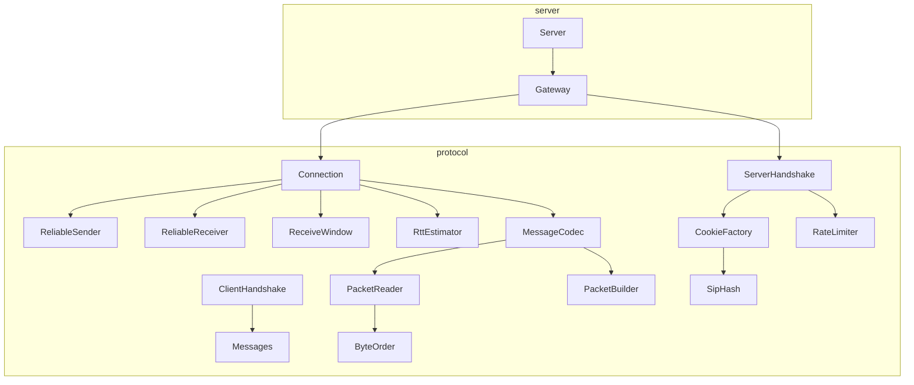

# Protocol implementation

This page maps the [protocol RFC](rtype-protocol.md) to the code. Everything below lives in
`protocol/` (namespace `rtype::protocol`) except the `Gateway`, which is in `server/`. Nothing in
`protocol/` does I/O or reads a clock: datagrams and time are passed in, so every behavior is
tested without a network.

## Layers



| RFC section | Code |
| --- | --- |
| 2 Conventions (big-endian, serial arithmetic, fixed point) | `ByteReader`, `ByteWriter`, `SerialNumber`, `FixedPoint` |
| 3 Datagram format, 4 Decoding procedure | `PacketReader` (cheap validation), `PacketBuilder` |
| 6 Messages | `Messages.hpp` (typed structs), `MessageCodec` (encode and decode) |
| 5.1 Sequence numbers and duplicates | `ReceiveWindow` |
| 5.2 Reliable ordered channel | `ReliableSender`, `ReliableReceiver` |
| 5.3 RTT | `RttEstimator` |
| 5 and 8.3 One side of a connection | `Connection` |
| 8.1 Handshake, anti-amplification | `ClientHandshake`, `ServerHandshake`, `CookieFactory`, `SipHash` |
| 8.2, 8.3, 11 Sessions, liveness, flood limits | `Gateway`, `RateLimiter` |

## How a datagram flows

Receiving, in `Connection::receive`:

1. `PacketReader::isValid` checks the header and every record (steps 1 to 5 of the decoding
   procedure). Any failure drops the whole datagram and changes nothing.
2. The session is compared, then `ReceiveWindow::check` rejects duplicates and too old datagrams.
3. Every reliable record is checked against the receive window of the reliable channel before
   anything is committed.
4. Only then the window, the acknowledgements and the RTT are updated, and the records are decoded
   with `MessageCodec::decodeBody` and handed to the game. Unknown types are skipped.

Sending, in `Connection::buildDatagram`: header with the current `ack` and `ack_bits`, then the
unreliable messages that fit, then the reliable records that are due (never sent, timed out, or
overtaken by three acknowledged datagrams). The result never exceeds 1200 bytes nor 64 records.

## Design choices

| Choice | Alternatives | Reason |
| --- | --- | --- |
| Cookie from SipHash-2-4 of the address and a 5 s slot | Table of pending hellos, plain hash, HMAC-SHA256 | No state before the client answers, and a keyed hash nobody can forge; SipHash is short, fast and has public test vectors. HMAC-SHA256 would need a crypto library for no gain here |
| Sticky-failure `ByteReader` | Exceptions, `std::optional` on every read | A truncated body can never read out of bounds, and the decoder stays `noexcept` and short |
| Typed `std::variant` messages | One class per message with virtual methods | Closed set, no heap, `std::visit` for encoding, equality for free in tests |
| Retransmission timeout of 1 s before the first RTT sample, then `2 x srtt` in [100 ms, 3 s] | A fixed 100 ms, full RFC 6298 (`srtt + 4 rttvar`) | A 100 ms start retransmitted needlessly on a 300 ms RTT link; the 1 s start follows RFC 6298 and the simple `2 x srtt` rule is enough for a fixed-rate game stream |
| `Connection` takes the time as a parameter | Reading the clock inside | Deterministic tests of retransmission and RTT, no sleep |
| One `Gateway` mutex | Lock-free structures | The network thread is the only hot caller, the others (simulation, tests) call rarely |

## Server statistics

Start the server with `r-type_server [PORT] [--stats]` to print one line every 5 seconds:

```
[net] clients=2 in=1.4 KB/s out=4.5 KB/s dropped=0 rtt=3ms
```

`in` and `out` are the UDP payload rates since the previous line, `dropped` counts the datagrams
rejected since the start (invalid, out of the reliable window, rate limited or unknown senders), and
`rtt` is the mean smoothed round trip time of the clients. `Gateway::stats()` returns the same
counters, globally and per client, for tests and tools. Use it with `tools/netem.sh` to see the
effect of loss and latency.

## Limits of this implementation

- The server side of the game is wired by `GameBridge` (see the
  [architecture overview](../architecture/overview.md#server-wiring)), which turns simulation
  events into reliable records and builds the 20 Hz snapshots.
- Client prediction and interpolation (section 9.3) are client work, in `client/`
  (see the [client architecture](../architecture/client.md)), not in the protocol library.
- No compression, no delta snapshots, no lag compensation.
- Confidentiality and integrity are out of scope of version 1 (section 11).

Measured bandwidth and reliable-channel behaviour: [Network measurements](measurements.md).
