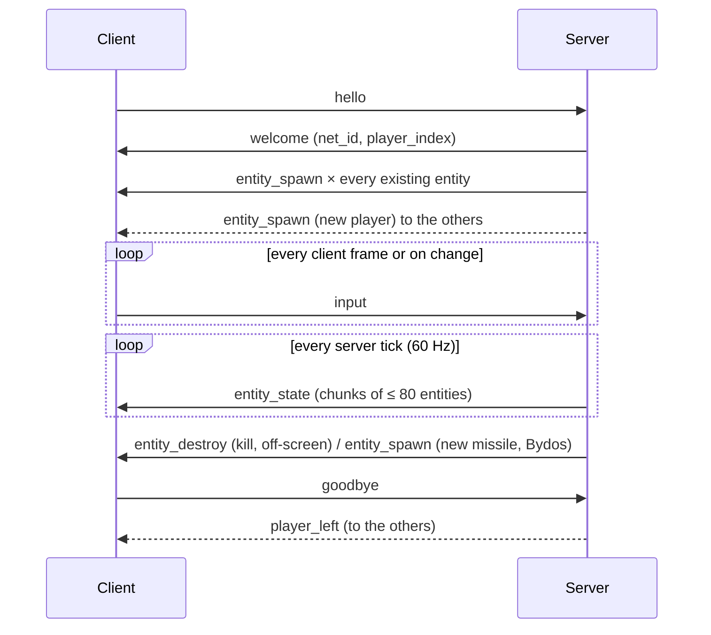

# R-Type network protocol (version 1)

This document is enough to write a new client. The reference implementation is in
`protocol/` (`packet.hpp`, `packet.cpp`).

## 1. Transport

- **UDP**, IPv4. Default server port: **4242**.
- One datagram carries **exactly one message**.
- A datagram is at most **1200 bytes** (header included). Larger datagrams are ignored.
- All integers are **big-endian** (network order). Floats are **IEEE-754 binary32**, sent as
  their 32 bits in big-endian order.

## 2. Header

Every message starts with a 6-byte header:

| Offset | Size | Field | Value |
| --- | --- | --- | --- |
| 0 | 2 | magic | `0x5254` ("RT") |
| 2 | 1 | version | `1` |
| 3 | 1 | type | see section 4 |
| 4 | 2 | length | payload size in bytes (datagram size minus 6) |

A receiver MUST silently drop a datagram when: it is shorter than the header, the magic or
version differ, the type is unknown, `length` does not equal the number of remaining bytes, or
the payload does not match the type's layout exactly (missing **or trailing** bytes).

## 3. Common types

`entity_data` (14 bytes):

| Offset | Size | Field | Notes |
| --- | --- | --- | --- |
| 0 | 4 | net_id | unique id of the entity, never reused during a session |
| 4 | 1 | kind | 1 = player ship, 2 = Bydos, 3 = missile |
| 5 | 1 | player_index | 0..3. Owner for ships and missiles, 0 otherwise |
| 6 | 4 | x | float, top-left corner, world pixels |
| 10 | 4 | y | float |

Coordinates MUST be finite and within ±100000, `kind` within 1..3, `player_index` within 0..3,
otherwise the message is dropped. The playfield is 1280 x 720.

`keys` bitmask (1 byte): bit0 up, bit1 down, bit2 left, bit3 right, bit4 shoot. Bits 5-7 MUST
be 0.

## 4. Messages

| Type | Name | Direction | Payload |
| --- | --- | --- | --- |
| 1 | `hello` | client → server | `name_length` (u8, ≤ 16) + `name_length` bytes (no control characters) |
| 2 | `welcome` | server → client | `net_id` (u32) + `player_index` (u8, 0..3) |
| 3 | `goodbye` | both | empty |
| 4 | `input` | client → server | `keys` (u8) |
| 5 | `entity_spawn` | server → client | one `entity_data` |
| 6 | `entity_state` | server → client | `count` (u8, ≤ 80) + `count` × `entity_data` |
| 7 | `entity_destroy` | server → client | `net_id` (u32) |
| 8 | `player_left` | server → client | `player_index` (u8, 0..3) |

### Example

An `input` message with `left + shoot` pressed (`keys = 0x14`):

```
52 54 01 04 00 01 14
```

## 5. Session flow



1. The client sends `hello` and repeats it every second until it receives `welcome`.
2. A `hello` from an already known address is answered with `welcome` again (the first one
   may have been lost).
3. If all 4 slots are taken, the server answers `goodbye`.
4. The client sends `input` whenever the pressed keys change, and at least every 100 ms
   while connected (so one lost packet is quickly repaired).
5. The server sends `entity_state` every tick. A client that receives a state for an unknown
   `net_id` SHOULD create the entity (its `spawn` may have been lost).
6. A client SHOULD forget an entity not updated for 1 second (its `entity_destroy` may have
   been lost).
7. When a ship is destroyed, its owner is respawned after 2 seconds: the server sends a new
   `entity_spawn` and a new `welcome` carrying the new `net_id`.

## 6. Liveness and failures

- A client silent for **5 seconds** is dropped by the server, which broadcasts `player_left`.
  This is how a crashed client is detected.
- `goodbye` from a client removes it immediately (and triggers `player_left`).
- `goodbye` from the server means it is shutting down (or the game is full).
- Datagrams from unknown addresses are ignored, except `hello`.

## 7. Robustness rules (server and client)

- Never trust a length or a count: check it against the bytes actually received.
- Drop, never crash: a malformed datagram is discarded and counted.
- Queues of pending datagrams are bounded; overflow is dropped.
- The reference decoder is exercised by unit tests including 200 000 random datagrams,
  every truncation of a valid packet and every single-bit mutation.

## 8. Not covered yet (future versions)

Acknowledgements for reliable events, delta-compressed snapshots, authentication, IPv6.
