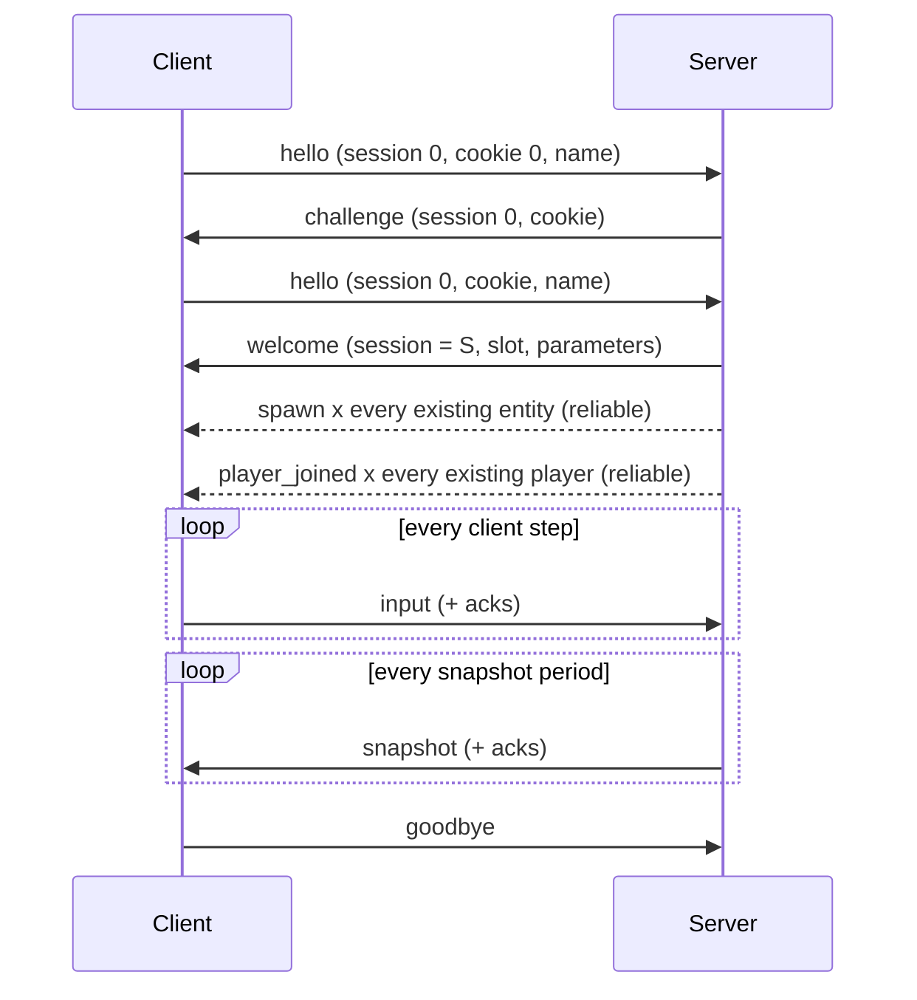

# R-Type network protocol (version 1)

This document is enough to write a new client or server. The reference implementation is in
`protocol/`. The key words MUST, SHOULD and MAY are used in the sense of RFC 2119. The reasons
behind each choice are in [Design decisions](../decisions.md#network-protocol).

## 1. Overview

- **UDP** only. One datagram carries a 16-byte header and a list of **records** (messages).
- A small **reliability layer** (sequence numbers, acknowledgements, duplicate detection) lives
  in the header. It gives an unreliable channel for state and a **reliable ordered channel** for
  events (spawn, destroy, score, ...), over the same datagrams.
- A connection starts with a **stateless cookie handshake** and is then identified by a random
  **session** number, so spoofed or blind packets are ignored.
- The server is authoritative. Clients send **inputs** only. The server sends **sparse absolute
  snapshots** of positions plus reliable events.
- Everything on the wire is an integer: no floating point, so there is no NaN or infinity to
  validate. Positions are fixed point (1/16 pixel).
- The format can evolve without breaking old peers (section 12).

## 2. Conventions

- Transport: UDP over IPv4. IPv6 is allowed: nothing in the protocol depends on the address
  family. Default server port: **4242**.
- A datagram is at most **1200 bytes** (header included). Larger datagrams are ignored.
- All integers are **big-endian**. `u8`, `u16`, `u32`, `u64` are unsigned, `i16` is two's
  complement.
- **Serial arithmetic.** `u16` and `u32` counters wrap around. `a` is *newer* than `b` when
  `(a - b) mod 2^n` is in `1 .. 2^(n-1) - 1` (n = 16 or 32). The same rule applies to `seq`,
  `rel_id`, `input_id` and `tick`.
- **Fixed point.** A position is an `i16` in units of **1/16 pixel** (range ±2048 px). A
  velocity is an `i16` in units of **1/16 pixel per second**. Every `i16` value is valid.
- `player_index` is `0..15` (the game currently uses `0..3`). `0xFF` means *none* where a field
  allows it.
- Strings (`name`) are printable ASCII (`0x20..0x7E`), prefixed by a `u8` length, not
  terminated.

## 3. Datagram format

### 3.1 Header (16 bytes)

| Offset | Size | Field | Notes |
| --- | --- | --- | --- |
| 0 | 2 | magic | `0x5254` ("RT") |
| 2 | 1 | version | `1` |
| 3 | 1 | flags | bit0 `ACK_VALID`. Bits 1-7 MUST be 0 (bit1 and bit2 are reserved for compression and encryption) |
| 4 | 4 | session | `0` before the connection exists, then the value given by `welcome` |
| 8 | 2 | seq | sequence number of this datagram, counted per direction, +1 for **every** datagram sent |
| 10 | 2 | ack | highest `seq` received from the peer (only if `ACK_VALID`) |
| 12 | 4 | ack_bits | bit `i` set means `seq = ack - 1 - i` was received (only if `ACK_VALID`) |

If `ACK_VALID` is 0, `ack` and `ack_bits` MUST be 0. Every datagram sent after the first
datagram received from the peer SHOULD carry `ACK_VALID`.

The first `seq` of a direction is chosen freely (0 is fine). The first datagram accepted from a
peer fixes the receive window (section 5.1).

### 3.2 Records

After the header, the payload is a sequence of records until the end of the datagram:

| Size | Field | Notes |
| --- | --- | --- |
| 1 | type | see section 6. `0x00` is invalid |
| 2 | length | size of the body in bytes |
| length | body | layout depends on the type |

**Reliable** types are those with bit7 set (`type >= 0x80`). Their body **starts** with
`rel_id` (`u16`, section 5.2) and `length` includes it.

A datagram with **zero records** is valid: it is an acknowledgement or a keepalive. A peer MUST
NOT answer an empty datagram with an empty datagram, otherwise two peers would ping-pong
forever. A datagram holds at most **64** records.

## 4. Decoding procedure

A receiver MUST apply these steps in order. On any failure the **whole datagram is dropped**:
no reply, no state change, no acknowledgement; only a counter is incremented.

1. Size is `16 .. 1200` bytes.
2. `magic` and `version` match, `flags` bits 1-7 are 0, `ACK_VALID` consistency holds
   (section 3.1).
3. The `session` is consistent with the source address (section 8.2). The rule for an address
   with no connection also needs the records, so it is checked at step 5.
4. Walk the records: each has its 3-byte prefix, `length` does not run past the datagram, the
   record count is ≤ 64, reliable records have `length >= 2`, and the walk ends **exactly** on
   the last byte.
5. For each record of a **known type**: the body matches its layout exactly (no missing and no
   trailing byte) and every field is in range (section 6).
   A record of an **unknown type** is not an error: it is skipped (section 12).
6. Duplicate detection (section 5.1). A duplicate or too old datagram is dropped.
7. Only now commit the state (receive window, acknowledgements) and deliver the records to
   the game, reliable ones through the reliable channel (section 5.2).

Never trust a length, a count or an index: check it against the bytes actually received. A
decoder MUST NOT allocate memory based on a field before checking it against the datagram
size.

## 5. Reliability layer

### 5.1 Sequence numbers, acknowledgements, duplicates

Each side numbers its datagrams with `seq` and tells the other which datagrams it received
through `ack` and `ack_bits`. A datagram is acknowledged when `ack == seq` or when its bit is set
in `ack_bits` (so the last 33 datagrams are covered by every acknowledgement and a single lost
acknowledgement costs nothing).

Receive side, with `latest` the highest `seq` accepted so far and a 32-bit `seen` mask:

- `seq` newer than `latest`: accept, shift `seen` by the distance, `latest = seq`.
- `seq` equal to `latest`, or older with a bit already set in `seen`: **duplicate**, drop.
- `seq` older than `latest` by more than 32: **too old**, drop (a duplicate can no longer be
  ruled out).
- Otherwise: accept and set its bit (this is a reordered datagram).

This protects against network duplication and against replayed datagrams. It does **not**
discard stale state, which the game does itself with `tick` and `input_id`.

### 5.2 Reliable ordered channel

Reliable records are numbered with `rel_id` (`u16`, starting at 0 when the connection starts,
+1 per reliable record, independently for each direction).

Sender:

- Each reliable record is kept until a datagram that carried it is acknowledged.
- A record whose datagram is considered lost SHOULD be sent again, inside any later datagram,
  with the **same** `rel_id`. A datagram is considered lost when it is not acknowledged after
  `max(2 × RTT, 100 ms)`, or when three newer datagrams have been acknowledged.
- At most **128** reliable records may be outstanding (not acknowledged). Beyond that, new ones
  wait in a queue. If the queue exceeds **1024** records the peer cannot keep up and the
  connection is closed with `goodbye` reason `QUEUE_OVERFLOW`.

Receiver (`next` is the next expected `rel_id`, initially 0):

- `rel_id == next`: deliver, `next++`, then deliver any buffered consecutive records.
- `rel_id` older than `next`: already delivered, ignore the record (the datagram is still
  acknowledged).
- `rel_id` newer than `next` and within `next + 127`: buffer it.
- `rel_id` beyond that window: the peer is broken, drop the datagram.

Records are therefore delivered **exactly once and in order**. An unknown reliable type still
consumes its `rel_id` (it is delivered to nobody), which keeps the order intact.

### 5.3 RTT

The sender stores the sending time of each recent `seq`. When one is acknowledged for the first
time, `RTT = now - sent_time` feeds a smoothed estimate (for example
`srtt += (rtt - srtt) / 8`). No dedicated ping message exists.

## 6. Messages

Types with bit7 clear are unreliable, with bit7 set reliable. A **body** below does not repeat
`rel_id` for the reliable ones: add 2 bytes at the start of the body. In the tables, "length"
is the body length written in the record.

| Type | Name | Direction | Reliable | Body |
| --- | --- | --- | --- | --- |
| `0x01` | `hello` | C → S | no | `cookie` (u64), `name_length` (u8, ≤ 16), `name` |
| `0x02` | `challenge` | S → C | no | `cookie` (u64) |
| `0x03` | `welcome` | S → C | no | see 6.1 |
| `0x04` | `reject` | S → C | no | `reason` (u8) |
| `0x05` | `goodbye` | both | no | `reason` (u8) |
| `0x10` | `input` | C → S | no | `first_id` (u16), `count` (u8, 1..8), `count` × `keys` (u8) |
| `0x11` | `snapshot` | S → C | no | `tick` (u32), `input_ack` (u16), `count` (u8, ≤ 128), `count` × `state` |
| `0x81` | `spawn` | S → C | yes | see 6.3 |
| `0x82` | `destroy` | S → C | yes | `net_id` (u16), `reason` (u8), `killer` (u8) |
| `0x83` | `player_joined` | S → C | yes | `player_index` (u8), `name_length` (u8), `name` |
| `0x84` | `player_left` | S → C | yes | `player_index` (u8), `reason` (u8) |
| `0x85` | `score` | S → C | yes | `player_index` (u8), `score` (u32) |
| `0x86` | `game_state` | S → C | yes | `phase` (u8), `level` (u8) |

`length` MUST equal the layout size exactly: for example `input` is `3 + count`, `snapshot` is
`7 + 6 × count`, `hello` is `9 + name_length`, and `destroy` is `2 + 4`.

### 6.1 Connection messages

`welcome` (S → C), 14 bytes. It is the only message sent with the new `session` in the header:

| Offset | Size | Field | Notes |
| --- | --- | --- | --- |
| 0 | 1 | player_index | the slot of this client, `< max_players` |
| 1 | 1 | max_players | 1..16 |
| 2 | 1 | tick_rate | simulation rate in Hz, 1..240 (60 by default) |
| 3 | 1 | snapshot_rate | snapshots per second, 1..`tick_rate` (20 by default) |
| 4 | 2 | world_width | pixels, ≥ 1 (1280 by default) |
| 6 | 2 | world_height | pixels, ≥ 1 (720 by default) |
| 8 | 2 | ship_speed | pixels per second, used by the client prediction |
| 10 | 4 | server_tick | current simulation tick, to synchronise the clock |

Enumerations used in connection messages (open sets, section 12):

| `reject.reason` | Meaning |
| --- | --- |
| 1 | `SERVER_FULL` |
| 2 | `INVALID_NAME` |
| 3 | `VERSION` (the server version is in the header) |
| 4 | `RATE_LIMITED` |
| 5 | `SHUTTING_DOWN` |

| `goodbye.reason` | Meaning |
| --- | --- |
| 0 | `QUIT`, the peer leaves normally |
| 1 | `TIMEOUT`, the peer was silent too long |
| 2 | `SHUTDOWN`, the server stops |
| 3 | `PROTOCOL`, too many invalid datagrams |
| 4 | `QUEUE_OVERFLOW`, the reliable queue is full |

### 6.2 Input and snapshot

`keys` bitmask: bit0 up, bit1 down, bit2 left, bit3 right, bit4 shoot. Bits 5-7 MUST be 0.

`input`: `first_id` is the id of the first of the `count` samples, the next ones are
`first_id + 1`, ... The client numbers its input samples consecutively (one per simulation
step, 1/`tick_rate` second). A client SHOULD put its **last 4 samples** in every datagram, so
that one or two lost datagrams lose nothing.

`state` (6 bytes), one per entity:

| Offset | Size | Field | Notes |
| --- | --- | --- | --- |
| 0 | 2 | net_id | entity id, see `spawn` |
| 2 | 2 | x | i16, 1/16 px, top-left corner |
| 4 | 2 | y | i16, 1/16 px |

`snapshot`:

- `tick` is the simulation tick the positions belong to.
- `input_ack` is the `input_id` of the last input of **this** client the server applied.
- A snapshot is **sparse and absolute**: it lists only some entities, each with its full
  position, never a difference. A lost snapshot therefore needs no repair.
- The server MAY split the entities over several snapshot records with the same `tick`
  (they never exceed the 1200-byte limit).

### 6.3 Reliable events

`spawn` (body 15 bytes including `rel_id`):

| Offset | Size | Field | Notes |
| --- | --- | --- | --- |
| 0 | 2 | rel_id | |
| 2 | 2 | net_id | unique among the **living** entities, reused only after its `destroy` |
| 4 | 1 | kind | 1 player ship, 2 Bydos, 3 player missile, 4 Bydos missile |
| 5 | 1 | variant | sub-type of the kind (monster type, weapon type), 0 by default |
| 6 | 1 | owner | `player_index` of the owner of a ship or a missile, `0xFF` otherwise |
| 7 | 2 | x | i16, 1/16 px |
| 9 | 2 | y | i16, 1/16 px |
| 11 | 2 | vx | i16, 1/16 px per second |
| 13 | 2 | vy | i16, 1/16 px per second |

The velocity is a **hint**, used to extrapolate between two snapshot entries (section 9.2).

`destroy`: `reason` 0 left the screen or expired, 1 killed, 2 picked up. `killer` is the
`player_index` credited with the kill, or `0xFF`. A client that receives a `destroy` for an
unknown `net_id` ignores it.

`player_joined` / `player_left` tell the other clients who plays; `player_left.reason` uses the
`goodbye` values. `score` carries the new total. `game_state.phase`: 0 waiting, 1 playing,
2 game over; `level` is the current level number.

## 7. Limits

| Constant | Value |
| --- | --- |
| Datagram size | 16 .. 1200 bytes |
| Records per datagram | 64 |
| Name length | 16 |
| Inputs per `input` record | 8 |
| Entities per `snapshot` record | 128 |
| Outstanding reliable records | 128 |
| Reliable queue before disconnection | 1024 |
| Players | `max_players` ≤ 16 (4 in the current game) |

## 8. Connection

### 8.1 Handshake



1. The client sends `hello` with `cookie = 0` and repeats it every 500 ms. It gives up after
   10 s.
2. The server answers `challenge` with an opaque 64-bit `cookie` and **keeps no state** for
   this address (a keyed hash of the address and a coarse time works, or a bounded table of
   at most 64 entries). The cookie is valid for at least 5 s and only for the address it was
   sent to.
3. The client repeats `hello` with the cookie. If the cookie is valid, the server checks the
   name (it MUST NOT be empty, otherwise `INVALID_NAME`) and the free slots, creates the connection, picks a **random non-zero** `session`
   and sends `welcome`, followed by the reliable `spawn` and `player_joined` records of the
   current world. The other clients receive `spawn` and `player_joined` for the new player.
4. If the server cannot accept the client it answers `reject` instead (`SERVER_FULL`,
   `INVALID_NAME`, `RATE_LIMITED`, ...). A `hello` with a bad cookie is answered with a new
   `challenge`.
5. A `hello` carrying the cookie that already created a connection is answered with the same
   `welcome` again (the first one may have been lost). A `hello` with a **different** valid
   cookie from the address of an existing connection replaces it: the old connection is
   closed (`player_left` for the others) and a new session is created. This is how a client
   restarted on the same port gets back in.
6. The client accepts the first `welcome` it receives. From then on every datagram carries the
   session.

**Version mismatch.** If `magic` is correct but `version` differs, the receiver drops the
datagram. A server MAY answer, at most once per second per address and only if the datagram
it received was at least 20 bytes long, with a `reject` whose `reason` is `VERSION`, sent with
**its own version** in the header. A client reads only the
header of such a datagram and can tell the user "server speaks protocol N".

**Anti-amplification.** Before the cookie is validated, a server answers with at most as many
bytes as it received. A `hello` is at least 28 bytes, a `challenge` is 27 and a `reject` is 20.

### 8.2 Sessions and addresses

- The server accepts a datagram from an address with no connection **only** if it has
  `session = 0` and contains exactly one record, a `hello`. Everything else is ignored.
- For a connected address, `session` MUST equal the value of its connection. A mismatch drops
  the datagram.
- A client only accepts datagrams from the server address it connected to. While waiting for
  `welcome` it accepts `session = 0` (`challenge`, `reject`) or a datagram whose first record is
  a `welcome`, which fixes the session. Afterwards `session` MUST equal that value.
- The address (IP and port) is part of the identity. If the address of a client changes (NAT
  rebinding), the connection is lost and the client reconnects.

### 8.3 Liveness and failures

- Each side sends something (at least an empty datagram) at least every **1 s**. A client also
  sends `input` as often as it samples keys.
- A peer silent for **5 s** is dropped. For a client, the server broadcasts `player_left`
  (reason `TIMEOUT`). This is how a crashed client is detected: the server never waits for
  a client.
- `goodbye` removes the connection immediately. A `goodbye` from the server means it stops
  (`SHUTDOWN`) or kicks the client. `goodbye` is not retransmitted: the timeout covers a loss.
- A server SHOULD drop a connection that sent more than 50 invalid datagrams in 10 s
  (`goodbye`, reason `PROTOCOL`), and SHOULD limit each connection to about 200 datagrams per
  second.

### 8.4 Respawn

When a ship is destroyed, its owner is respawned after 2 s with a new `spawn`
(`kind = 1`, `owner = player_index`). The client recognises its own ship by `kind = 1` and
`owner = player_index` from `welcome`. There is no second `welcome`.

## 9. Game synchronisation

### 9.1 Time

The server simulates at `tick_rate` Hz and numbers its steps with `tick`. The client estimates
the server clock from `welcome.server_tick` and from each snapshot. Nothing on the wire is a
wall-clock time, and no timer depends on the speed of the CPU.

### 9.2 Server rules

- The server is authoritative: it ignores everything from a client except `input`.
- It consumes **at most one input sample per tick** and per client, in `input_id` order,
  ignores already applied ids, and holds the previous `keys` when an id is missing. It keeps at
  most 8 pending samples: a client cannot run faster than the server clock.
- It sends a `snapshot` every `1 / snapshot_rate` s to each client. Priority guideline: ships
  and entities with non-linear motion in every snapshot, linear missiles every 4th snapshot.
- Anything lost must be repaired by the next snapshot (absolute positions) or by the reliable
  channel (events): the server never waits for a client to catch up.

### 9.3 Client rules

- **Interpolation.** Render the other entities about two snapshot periods in the past (100 ms
  at 20 Hz), interpolating between the two surrounding entries. When the entry for an entity
  is missing, extrapolate with the velocity of its `spawn`, for at most 1 s.
- **Prediction.** Apply your own keys at once to your own ship, with the movement rule of the
  game and `ship_speed`. Keep the inputs not yet acknowledged. When a snapshot arrives, start
  from the position it gives for your ship and replay the inputs whose id is newer than
  `input_ack`. This keeps the controls responsive and the server in charge.
- A `state` for an unknown `net_id` SHOULD create a generic entity (its `spawn` is reliable,
  so it is normally only late).
- A client SHOULD forget an entity not updated for 2 s and not killed by a `destroy`.
- The server knows the last snapshot a client has seen because acknowledgements are
  per datagram, so no timestamp is needed in `input` for lag compensation later.

## 10. Bandwidth

Size of a snapshot datagram: `16 (header) + 3 (record) + 7 + 6 × n` bytes for `n` entities.

| n | Datagram | At 20 Hz |
| --- | --- | --- |
| 10 | 86 B | 1.7 KB/s |
| 20 | 146 B | 2.9 KB/s |
| 40 | 266 B | 5.3 KB/s |

Client to server, with 4 samples per datagram at 30 Hz: `16 + 3 + 3 + 4 = 26 B`, about
0.8 KB/s. These figures meet the degraded-network target (about 5 KB/s). The server MAY lower
`snapshot_rate` for a client, or send fewer entities, when the link is slow. Reliable events
and acknowledgements add little: they ride in the same datagrams.

## 11. Security and robustness

| Threat | Mitigation |
| --- | --- |
| Malformed or truncated datagram, buffer overflow | Strict decoder (section 4), every length checked, whole datagram dropped, no allocation from a field |
| Spoofed source address filling the slots | Cookie handshake: no state before the cookie comes back |
| Blind injection of inputs | `session` is random and bound to the address |
| Reflection and amplification | A reply to an unverified address is never larger than the request |
| Duplicated or replayed datagram | Sliding window on `seq` (section 5.1), reliable `rel_id` |
| Slow or stalled client holding memory | Bounded reliable queue, bounded buffers, timeouts |
| Packet flood | Per-address `hello` rate limit (for example 5 per second), per-connection datagram cap |
| Cheating | Server authority: a client only sends keys, at most one sample used per tick |
| A client crash | Detected by the 5 s timeout; the server and the other clients go on |

Queues of pending datagrams are bounded on both sides; on overflow the new datagram is
dropped. **Not covered in version 1:** confidentiality and integrity. An attacker who can read
or modify the traffic on the path can forge datagrams. The `flags` bits reserved for
encryption allow adding an authenticated encryption later with a new version.

## 12. Compatibility and extension

- A **new message type** in an unused range does not change `version`. A receiver skips records
  of an unknown type (their length is known), and an unknown reliable type still consumes its
  `rel_id`. Use this for anything an old peer can safely ignore.
- A change to the header, to the layout of an existing message, to the meaning of a field or to
  the rules of a section MUST increase `version`. A peer only talks to the same version.
- **Enumerations are open**: an unknown `kind`, `variant`, `reason`, `phase` is accepted by the
  decoder and left to the game (a placeholder sprite, a generic message). New monsters,
  weapons and bosses need no protocol change. `player_index` is the exception: it is always
  validated.
- Reserved type ranges:

| Range | Use |
| --- | --- |
| `0x01..0x0F` | connection (used `0x01..0x05`) |
| `0x10..0x1F` | unreliable gameplay (used `0x10..0x11`) |
| `0x20..0x7F` | reserved, unreliable (ping tools, voice, ...) |
| `0x81..0x9F` | reliable gameplay events (used `0x81..0x86`) |
| `0xA0..0xFF` | reserved, reliable (lobbies, accounts, chat, scoreboard, admin) |

Planned for the next versions: lobbies and rooms, chat, delta compression of snapshots,
payload compression (`flags` bit1), authenticated encryption (`flags` bit2).

## 13. Examples

All values in hexadecimal. `|` separates the header and the records.

**`hello`**, first attempt, name "Bob", `seq = 0`:

```
52 54 01 00  00 00 00 00  00 00  00 00  00 00 00 00
| 01 00 0C  00 00 00 00 00 00 00 00  03 42 6F 62
```

**`input`**, `left + shoot` (`0x14`) with input id `0x0102`, session `A1B2C3D4`, `seq = 7`,
acknowledging `seq 16` and `15, 14, 13`:

```
52 54 01 01  A1 B2 C3 D4  00 07  00 10  00 00 00 07
| 10 00 04  01 02 01 14
```

**`snapshot`**, tick `0x1A2B`, last applied input `0x0102`, two entities:
entity 5 at (80, 180) px and entity 9 at (640, -16) px:

```
52 54 01 01  A1 B2 C3 D4  00 20  00 07  00 00 00 01
| 11 00 13  00 00 1A 2B  01 02  02
            00 05 05 00 0B 40
            00 09 28 00 FF 00
```

**`spawn`** record only (it travels after a header): reliable id 3, entity 9, player missile
of player 0, at (80, 180) px, moving right at 512 px/s:

```
81 00 0F  00 03  00 09  03 00 00  05 00 0B 40  20 00 00 00
```

## 14. Conformance tests

The reference decoder MUST pass at least: 200 000 random datagrams, every truncation of every
valid example, every single-bit mutation of every valid example, `seq` and `rel_id` wrap-around,
duplicated, reordered and too old datagrams, a reliable stream with 30 % loss delivered
exactly once and in order, and a handshake with a lost `challenge`, `welcome` and `hello`.
A new client or server can be checked with the hexadecimal examples above.

The reference tests live in `protocol/tests/`: `ConformanceTests` (random datagrams, truncations,
single-bit mutations, size and record limits), `ReceiveWindowTests`, `ReliableChannelTests` (30 %
loss and 10 % duplication, wrap-around), `ConnectionTests` (two peers over a lossy, reordering
link), `HandshakeTests` and `SecurityTests` (SipHash reference vectors, cookies, rate limiter).
`server/tests/NetworkTests` runs the whole stack over real UDP sockets on the loopback.

## 15. Reference implementation

See [Protocol implementation](implementation.md) for the mapping between the sections of this
document and the code.
